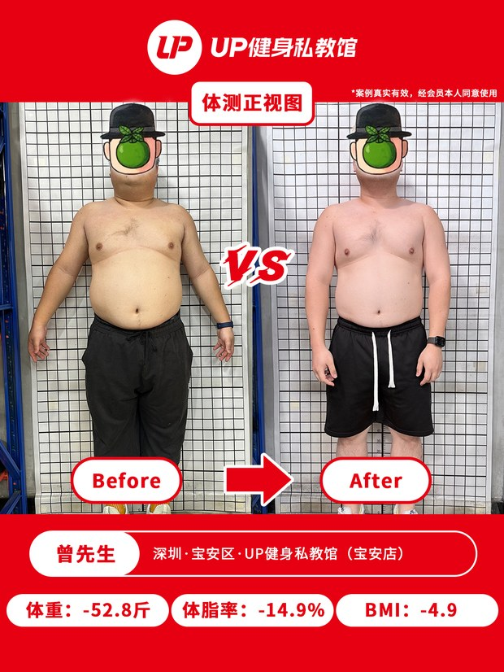
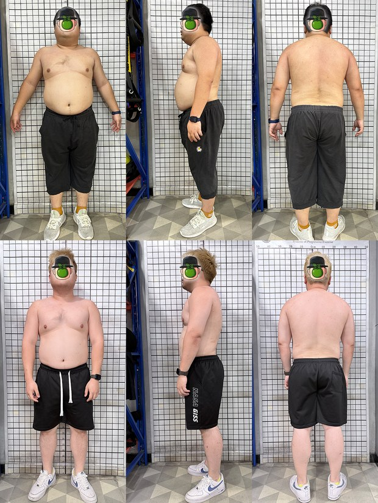
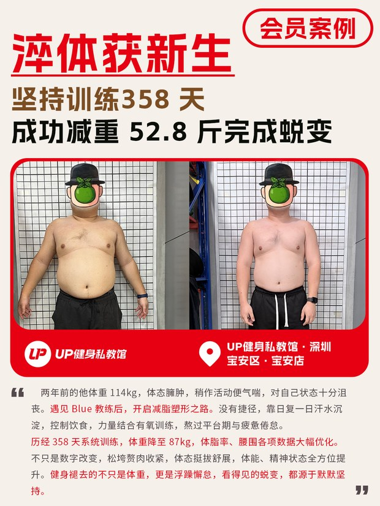
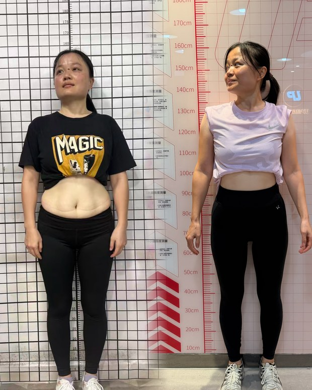
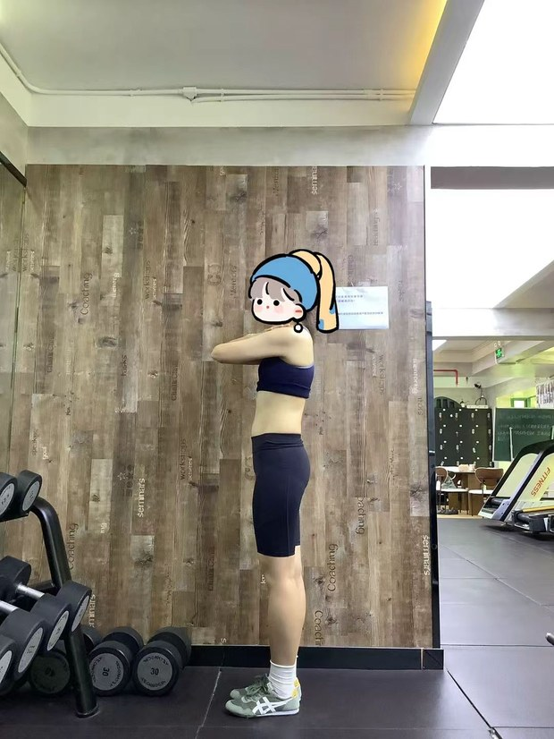

# 会员案例素材生产方案（v0.3）

> 2026-11-05 最新实验：[单人网格联合透视校正](10-单人网格校正.md)。当前只处理单人方格背景，对比图跳过；旧网格校正脚本已弃用。

> v2.2：[主体定位与大模型兜底](11-主体定位与大模型兜底.md)。YOLO 常规定位失败后才增加大模型粗框请求，区域 YOLO 再试，SAM 最后兜底。12 张单人回归样本已全部输出。

> v2.3：[网格范围矩形裁剪](12-网格范围矩形裁剪.md)。校正后以网格为主要取景范围，允许裁掉部分身体，输出无空白角的纯裁剪图，并保留校正全图。

> 一句话：**门店上传原始素材包，系统按 UP 健身的案例模板，逐会员产出成品卡片；素材里没有的东西，就不产出对应的成品。**

- 参考实现：`参考模板\宝安店-曾繁治（原始素材）` → `参考模板\宝安店-曾繁治（输出成品）`（1 个会员，16 个原始文件 → 17 张成品）
- 素材标准：`会员案例素材生产标准（说明文件）\UP会员案例素材标准化生产手册.pdf`（11 页）
- 本方案不动手写代码，只定义：**输入是什么、怎么识别、成品怎么算、缺料怎么降级、怎么渲染、系统怎么搭、哪些要你拍板**。

---

## 0. 我对需求的理解（请核对）

1. **目录分类**：`<店>/<会员名>/` 下是原始素材；`参考模板/` 是"目标态"（原始素材 → 成品）；`会员案例素材生产标准（说明文件）/` 是素材标准，且可能不全。
2. **任务意图**：照着参考模板的做法，用原始素材产出成品；**原始素材提供了什么就产出什么，没提供的就不产出对应成品**（例：体测三视图不够 6 张，就不出"会员体测三视图对比拼图"）。
3. **上传形态不定**：用户可能传"标准说明文件"的压缩包，也可能传"以店为单位"的素材包，需要系统用 AI 识别筛选后再决定是"更新标准"还是"开始生产"。
4. **现在只写方案，不写代码**。

## 0.1 已定的 12 件事（v0.3）

| # | 决策 | 落点 |
| --- | --- | --- |
| D1 | 面部贴纸做成**贴纸库**：可指定、未指定则随机（同一会员固定一张），支持 **AI 生成同风格贴纸** | `04-§5`、`05-§3` |
| D2 | 成品 = **三层**（用户照片 / 外框 / 文字描述）；用户写**提示词**生成文字层，生成后可**直接编辑文字并重新出图（覆盖）** | `03-§4`、`04-§2`、`05-§4` |
| D3 | 输出走**存储接口**（本地/COS 双实现）；本期按 D7 只落本地 | `05-§2` |
| D4 | `A-B` 目录 = **教练-会员** | `01-§6.3` |
| D5 | 其余按方案建议执行 | `06-§B` |
| D6 | 贴纸：一次性生成 **100 张**入库，生成完**卸载模型** | `06-D6`、`04-§5` |
| D7 | COS **暂缓**，本期只走本地目录 | `06-D7`、`05-§2` |
| D8 | **无用户/角色**，单一 access token 进站即用 | `06-D8`、`05-§8.1` |
| D9 | 几何矫正**只对报告类**；生活照/训练照只纠正方向 | `06-D9`、`07-§4` |
| D10 | 去重**强制执行** | `06-D10`、`07-§6` |
| D11 | 低质**默认丢弃**，可人工强制使用/更换素材 | `06-D11`、`08-§7.1` |
| D12 | **MP4 暂不处理**（只登记） | `06-D12`、`07-§3` |

---

## 1. 任务本质

不是"图片美化"，是**素材驱动的批量生产**：

```
素材包(门店/会员/*)  →  逐文件识别分类  →  逐会员汇总素材清单  →  按依赖矩阵决定出哪些成品  →  渲染  →  打包交付
```

四个决定性约束：

1. **素材形态极不规整**：文件名是 hash（`4333be43...(1).jpg`）、体测图可能一张图里前后两人同框、报告是斜着拍的翻拍照、训练日常是 mp4、有的图已经被人贴过表情包。
2. **素材经常不全**：石厦店 8 个会员里有 7 个文件夹名直接写着"（缺生活照）""（缺日常训练图）"。所以缺料是常态，不是异常。
3. **成品是设计稿**：1080×1440、红色品牌条、VS 箭头、指标胶囊、面部贴纸、姓名打码。像素级还原才叫合格。
4. **成品是可编辑的**：设计拆成三层——照片层、外框层、文字层；文字层结构化存起来，改一句话就能重出一张图，不用重跑素材识别。

## 1.1 五个核心能力

| 能力 | 说明 |
| --- | --- |
| 素材识别 | 6 类素材 + 三视图 + 前后 + 身份，全部带置信度，低置信度进人工复核 |
| 产出决策 | 依赖矩阵决定"出哪几张"，缺什么不出什么，附缺口清单 |
| 三层合成 | photo + frame + text，文字层可单独编辑重渲染 |
| 贴纸库 | 会员级固定分配，渲染不缩放、中心对齐；支持 AI 生成同风格扩充 |
| 存储适配 | 本地目录 / 腾讯云 COS 二选一，配了就用，没配不影响功能 |

## 2. 输入：三种包，需要自动区分

上传的压缩包可能是：

| 类型 | 特征 | 系统动作 |
| --- | --- | --- |
| **标准包** | 含 `UP会员案例素材标准化生产手册.pdf`、`会员案例素材清单.png`、空白报告 PDF | 解析成"素材清单 + 拍摄要求"规则，**不产出成品**；版本化保存，作为判定依据 |
| **门店素材包** | `<店名>/<会员目录>/<图片/视频/文档>`，如 `宝安店/任胜男-candy/` | 进入生产流程 |
| **参考模板包** | 含 `参考模板/宝安店-曾繁治（原始素材）`+`（输出成品）` | 作为黄金样本，用于回归比对（不改模板时只归档） |
| 混合包 | 顶层同时有多类目录 | 按顶层目录拆分后按上表分别处理 |

识别方式：**文件树结构 + 文件名关键词 + 抽样视觉判定**（见 `01-素材识别与分类.md` §5），不确定时让用户在界面上点一次确认，而不是猜。

## 3. 输出：成品清单（模板实测 17 张，最多 18 张）

> 参考样例给了 3 段训练视频但只出了 `训练日常1/2` 两张；已定"每条可用素材 1 张、上限 3 张"，所以最多可到 18 张。

| # | 成品 | 依赖 |
| --- | --- | --- |
| 1–3 | 会员体测正视图（训练前 / 训练后 / 前VS后） | 正视前、正视后（+ 指标） |
| 4–6 | 会员体测侧视图（训练前 / 训练后 / 前VS后） | 侧视前、侧视后 |
| 7–9 | 会员体测后视图（训练前 / 训练后 / 前VS后） | 后视前、后视后 |
| 10 | 会员体测三视图对比拼图 | 三视图 × 前后共 6 张 |
| 11 | 会员案例封面 | 正视前+后、指标变化、文案 |
| 12 | 会员生活照（训练前VS训练后） | 生活照前、后 |
| 13 | 会员感言 | 感言截图 1–2 张 |
| 14 | 会员训练报告 | 训练成果报告（docx/pdf） |
| 15 | 会员体测报告&训练报告文件 | 体测报告 2 张（+ 报告数据表） |
| 16–18 | 会员训练日常 1..N | 日常训练图/视频帧，每条一张，最多 3 张 |

完整依赖矩阵、降级规则、命名规范见 `02-成品矩阵与降级规则.md`。

## 4. 核心原则：缺什么不出什么

- **硬依赖**：三视图拼图必须 6 张齐（少一张就整张不出）。
- **软降级**：只有"前"没有"后"，出单图（训练前），不出 VS、不出封面。
- **部分产出**：一个会员可能只出 3–5 张成品；这在石厦店那种"缺 3 项"的会员上是正常结果。
- **交付必须带缺口清单**：每批输出一个 `缺失说明.md` + 界面上的"素材体检"面板，写清楚"缺哪一项、导致哪几张成品没生成"——现有流程靠文件夹名手工标注缺失，系统要把这件事自动化。

## 5. 处理流程（12 步 · 3 段）

```
【输入段：把任意素材变成系统能吃的形态】
 1  解包与安全     zip/tar.gz/7z，拒穿越/符号链接/加密/炸弹，过滤 __MACOSX/.DS_Store
 2  包识别         标准包 / 门店包 / 模板包 / 混合包 → 拆到"会员"粒度
 3  归一化         HEIC/RAW/PDF 转码、EXIF 方向、三档图（thumb/work/full）
 4  强制去重       sha256 + pHash，分类之前做，省 API 额度
 5  质量评分       清晰度/曝光/人物占比/分辨率 → 默认丢弃，可强制使用/更换素材

【理解段：判断这是什么、能不能用、属于谁】
 6  素材分类       6 类 + 三视图 + 训练前/后 + 是否会员（VLM，带置信度）
 7  文档矫正       只对报告类：四角单应 → UVDoc → DocRes，失败回退原图
 8  结构抽取       报告 docx/pdf/翻拍 → 指标表 + 一致性校验（冲突项不上图）
 9  会员归并       分组、前后排序、教练/会员身份确认

【生产段：算出该出哪几张、把它们画出来、验完再交】
10  产出决策       依赖矩阵 → 出哪些成品 + 缺口清单（缺什么不出什么）
11  内容准备       会员级贴纸分配 + 文字层生成（提示词 + 事实 → 结构化 JSON）
12  出图与交付     三层合成渲染 → 8 道质量护栏 → 本地存储 → 打包 + manifest
```

三步一句话：**第 1–5 步决定"素材能不能用"，第 6–9 步决定"素材是什么"，第 10–12 步决定"出哪几张、长什么样、怎么交"。**

其中第 6、7、8、11 步是 AI 的主战场；第 10 步是纯规则；**第 12 步必须确定性**（同一输入必须出同一张图，不能靠模型每次现画）。

容错不是某一阶段的补丁，而是贯穿全程的四条原则：**分级隔离、绝不静默出错、确定性、可重放**——详见 [08-容错与工作流.md](08-容错与工作流.md)。

## 6. 与已有能力的关系

上一轮的「四向 Portrait Studio」已经把这块基础设施跑通了，可直接复用：

| 能力 | 现状 | 本方案用途 |
| --- | --- | --- |
| YOLO11n 人物检测 + SAM 2.1 分割 | 已在 4090 上跑通，显存 1.6 GB | 体测图单人化、人物居中、左右/前后分离 |
| YuNet 人脸检测（28/30 命中） | 已接入 | 面部贴纸定位（不缩放、中心对齐） |
| DeepSeek-V4.1-Flash 视觉 | 已接入，3 并发 | 素材分类、翻拍报告 OCR、前/后判别 |
| 贴纸遮罩（可配置图、可不缩放） | 上一轮已做完 | 会员面部脱敏，本轮升级为"贴纸库" |
| 任务队列 + 进度 + 打包下载 | 已有 | 直接复用作业模型 |
| T2I 文生图（本轮新增） | 未装，需 SDXL/Flux | 离线扩充贴纸库 |
| 对象存储（本轮新增） | 腾讯云 COS | 成品外发/分发 |

差异：本项目**输出的是设计稿**，渲染层要重做（见 `04-视觉规范与渲染.md`），并且多了"数据/文案/存储"三层。

## 7. 文档索引

| 文档 | 内容 |
| --- | --- |
| [01-素材识别与分类.md](01-素材识别与分类.md) | 6 类素材定义、真实素材形态、识别流水线、难点规则、置信度 |
| [02-成品矩阵与降级规则.md](02-成品矩阵与降级规则.md) | 成品依赖矩阵、降级/中止规则、输出命名与存储目标 |
| [03-数据抽取与文案.md](03-数据抽取与文案.md) | 指标字段、来源优先级、一致性校验、**文字层生成与编辑**、脱敏 |
| [04-视觉规范与渲染.md](04-视觉规范与渲染.md) | 1080×1440 版式、**三层模型**、**贴纸库**、字体、渲染选型 |
| [05-系统架构与实施.md](05-系统架构与实施.md) | 编排、**存储适配（本地/COS）**、贴纸服务、文字层接口、里程碑、验收 |
| [06-决策记录与待确认.md](06-决策记录与待确认.md) | **决策记录**（已定 5 项 + 已采纳 8 项）+ 剩余待确认 |
| [07-预处理管线.md](07-预处理管线.md) | **面对没见过素材**：入库流程（对应第 1–6 步）、格式归一、文档矫正、开放集兜底、dry-run |
| [08-容错与工作流.md](08-容错与工作流.md) | **容错**：失败分类、三级失败域、状态机、幂等续跑、熔断、8 道护栏、故障注入 |

## 8. 主要风险（先摆出来）

1. **前/后判别**是准确率瓶颈：素材没有可靠标注，只能靠"同框切分 / 两张对比谁更胖 / 文件名 / 报告日期"。判错会让成品左右颠倒、指标对不上。→ 保留人工确认开关。
2. **长尾素材形态**：样例只有 19 个会员，真实批次会出现 HEIC 实况、竖拍横转、斜拍报告、截图、多人合影、损坏文件。→ 预处理层做归一化 + 开放集隔离 + 主动学习闭环（`07`）。
3. **数据准确性**：封面上的 `-52.8斤`、`-14.9%` 是营销数字，错一位就是事故。→ 以报告文档为准，InBody 翻拍只做交叉校验，冲突项不上图。
4. **已有贴纸的素材**（如潘艺文那张）：再贴一次会双层。→ 检测"是否已脱敏"，默认跳过。
5. **字体与渲染一致性**：中文字体缺失会让字重/字宽走形。→ 启动自检失败，不静默降级。
6. **AI 贴纸风格漂移**：生成图容易越画越"AI 味"。→ 参考图条件 + 人工入库审核 + 风格版本号。
7. **提示词越权**：用户提示词可能诱导 AI 编数据。→ 事实白名单 + 数字回查 + 敏感词拦截。
8. **COS 权限**：密钥给大了会出事。→ 子账号最小权限 + 私有读 + 签名 URL。
9. **素材版权/肖像**：贴纸脱敏 + 姓名打码只解决展示层，导出包仍需人工过一遍。

---

*版本：v0.3（2026-11-04）。基于对 `E:\demo\私教会员案例项目` 的实际素材与参考成品分析撰写；v0.3 并入贴纸一次性生成、COS 暂缓、单一 token、分类感知矫正、强制去重、低质放行、MP4 暂不处理七项决策。样例见 `assets/`。*

---

## 9. 测试数据（已上传服务器）

```
/root/autodl-fs/qa/demo-cases/私教会员案例项目/
  ├── 宝安店/任胜男-candy             12 个文件
  ├── 景田店/（9 个会员）             约 95 个文件
  ├── 石厦店/（8 个会员）             约 90 个文件
  ├── 参考模板/（原始 16 + 成品 17）
  └── 会员案例素材生产标准（说明文件）/ 4 个文件
```

统计：207 张 jpg、13 个 mp4（本期只登记）、5 个 pdf、3 个 docx、1 个 psd（约 290 MB）。
M1/M2 的回归直接跑这份数据，不用再传。

---

## 附：关键样例（截自参考模板与真实素材）

**成品：体测正视图 VS 卡**（1080×1440，红条 + VS 箭头 + Before/After + 指标胶囊）



**成品：三视图对比拼图**（上=训练前，下=训练后，2×3 无间隙）



**成品：案例封面**（主标题 + 数据副标题 + 双图 + 故事正文）



**真实素材：一张图里前后同框**（必须切分，否则无法出 VS 版）



**真实素材：已经被人贴过表情包的体测图**（需识别并跳过，避免双层贴纸）


