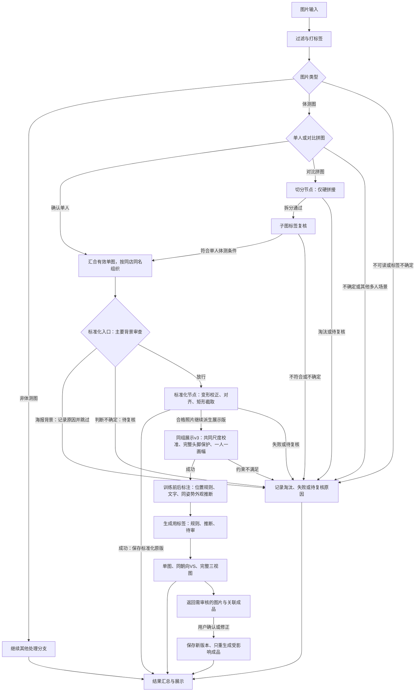

# 体测图分类、拆分、标准化与同组展示工作流

记录日期：2026-11-05。

**状态：处理流程已记录，各阶段可独立运行；完整工作流编排尚未实现。** 硬拼接拆分、单人体测图标准化及标准化后的同组尺寸统一均已有独立最佳实践。海报过滤已在v4标准化入口；同组v3已串接尺度与取景。6008网站现已接入“阶段结果→体测成品→人工审核→重生成”，ZIP上传到这些节点的完整调度仍未接通。

2026-11-06新增并获准归档：[非网格相机校正检查与回退](non-grid-geometry-guard.md)，已并入 [单图标准化最佳实践v4](../../best-practices/body-scan-wall-v4/README.md) 默认入口，在墙面校正后、同组展示前执行。五组28张实验仅改变1张，其余27张最终成品逐字节不变。旧v3和旧同组v2已从当前目录清理，历史由Git保留；新链路使用拆分 `--split-only` → v4完整标准化 → 下述同组展示v3。

同日用户批准[同人尺度校准](person-scale-calibration.md)，归档为[同组展示v3](../../best-practices/body-scan-group-display-v3/README.md)：在标准化与最终共同取景之间增加共同中立参考、网格/墙面尺度传递和等比定标，解决“画幅与肩部相同，但人物大小不同”。v3自动生成或复用基线展示完整度及SAM实测轮廓，防止新增头脚截断；尺度证据不足时保留并标记复核。

## 目标与主流程

将拆分、标准化及同组展示最佳实践分别作为处理节点，由工作流负责输入筛选、标签、分流、节点衔接与结果汇总，方便以后增加面部遮罩、质量检查、成品拼接等节点。

1. 对传入图片进行过滤和打标签。
2. 找出体测图：单人体测图直接进入标准化；对比体测图先拆分，再独立确认子图标签。
3. 标准化v4入口审查原图主要背景；海报背景记录原因并跳过，其余符合条件的单人体测图进行变形校正、墙面精修、可疑非网格几何检查与必要回退，再完成肩髋对齐与最大矩形取景。回退时重新计算坐标，从原图生成最终结果。
4. 标准化后进入同组展示v3：按同店同名建立共同尺度参考、等比校准和完整头脚保护，再以整组共同可见范围选择**一种**输出比例和取景框，另存有限纵向调整的展示版。完整度不用于拆分同一个人的画幅。详见[尺度校准](person-scale-calibration.md)与[共同取景](group-display.md)；完整网站编排仍未接入。
5. 独立训练前后标注节点：左右拆分按左前右后，其余优先文字标记，无标记时同人同朝向用原图和等比参考比较体形、体态、肌肉。2026-11-06新增[拍摄批次与多朝向版本](training-phase-sessions.md)：先复核批次，再观察变化、换序检查及跨朝向汇总，可靠批次才允许传播；[旧版逐对标注](training-phase.md)继续保留。同日进一步新增[局部观察与报告辅助实验](training-phase-regions.md)：逐部位检查可比性、并排局部图、独立报告转录及最后融合，不做人体轮廓强行重叠，不以报告日期冒充照片已确认日期。
6. 汇总成功结果、阶段标签、淘汰原因和待复核记录。

**非体测图跳过体测处理分支，继续其他处理分支；这不等于删除或淘汰所有非体测素材。**

图中的“子图标签复核”是独立职责，当前拆分最佳实践已在内部完成；接入时复用其结果，不重复调用分类。单图汇合后保留同店同名的组信息，使原有单人照片和拆出的子图都能参与后续同组处理。

## 节点职责

| 节点 | 输入与职责 | 输出与衔接 |
| --- | --- | --- |
| 过滤与打标签 | 原始图片及门店、会员等来源信息；识别素材类型、主体人数、对比属性、背景、朝向、体测姿势等 | 带标签和判断依据的素材；不可读或不确定项记录原因 |
| 类型分流 | 根据标签选择体测分支；非体测图交给其他分支 | 单人图直达标准化准备阶段，对比图进入切分；不能把同一场景中有两个人直接当作拼图 |
| 切分 | 调用硬拼接最佳实践的仅拆分模式；确认版式和接缝、保护主体、复核拆分，并独立分类子图 | 原尺寸无损子图、子图标签、母图关系、裁切坐标和验证记录；只将合格子图交给后续节点 |
| 单图汇合与分组 | 合并上游合格单图及切分后的合格子图，保留同店同名关系 | 标准化节点的统一输入；不把切分产生的子图误当成无来源的新会员 |
| 标准化 | 入口审查原图，排除以海报为主要背景的素材并记录原因；其余复用单图最佳实践的网格/非网格校正、肩髋定位、比例和位置对齐、最大有效矩形截取 | 标准化成品及背景审查、几何、取景、有效区域和坐标记录；不再次切分拼图 |
| 同组展示v3 | 只按同店同名分组；共同参考等比定标、完整头脚保护，再执行肩部共同取景；最终整组只采用一种画幅和共享展示变换 | 原标准化保留；另存校准结果、等比参考与展示版。尺度证据不足保留并记录；共同取景失败另记待复核，不能按单图另建画幅 |
| 结果汇总 | 接收各分支的产物和状态 | 成功图片、预览及下载信息，以及淘汰、失败、待复核清单；具体网站接入另行实现 |
| 训练前后标注 | 验证父子位置规则与文字；未知项按同店同名同朝向比较原图和等比参考，并交换输入复核 | 前后/未知、来源、置信度、依据及槽位候选；不使用非等比展示版推断，不覆盖原图 |
| 生成与审核 | 独立保留分析结论；采用已有推断，其余以支持分和可靠批次/配对约束选阶段 | 每张合格图都有生成标签；推断与待审标记进入成品及机器可读审核清单；用户修正后仅重生成关联成品，保留旧版本 |

## 当前处理节点与版本绑定

### 切分节点

- 权威副本：[best-practices/body-scan-pairs](../../best-practices/body-scan-pairs/README.md)。
- 批准算法来源提交：`5dec62c3b96eedd84c8159d071dbb289957815c4`。
- 入口：`best-practices/body-scan-pairs/scripts/body_scan_pairs/run.sh`，**工作流接入时必须使用 `--split-only`**。
- 当前切分入口默认会继续执行v4完整标准化，并验证几何检查标记；如果直接采用默认模式，再衔接标准化节点，就会重复执行。工作流中的切分节点仅输出通过拆分和独立分类的子图job。
- 新增阶段标签的开发入口：`scripts/body_scan_pairs/run.sh --split-only`（`body-scan-pairs-v2-phase`）。冻结入口仍按历史规则保留未知；新增标注节点能读取其父子报告补上左右标签，无须改冻结快照。

### 标准化节点

- 当前权威副本：[best-practices/body-scan-wall-v4](../../best-practices/body-scan-wall-v4/README.md)，来源提交 `7cfbb0d23e27a570f52120fe8d0d1d8c148b3a3c`。
- 当前入口：`best-practices/body-scan-wall-v4/scripts/run_body_scan_refined.sh`，自动执行 `standardization-background-v1` 背景审查、网格/相机/墙面处理及可疑非网格几何检查。已有v2/v3结果通过同目录 `scripts/run_refinement.sh` 升级。
- 历史 [body-scan-wall v3](https://github.com/zmdo/smart-pos/blob/ec5dcb4cda00534b7547dbaaa54177b4d5cfe503/best-practices/body-scan-wall/README.md) 的来源是 `c3ce38966da8d39cf702778858e8e5881f9744ff`，现仅保存在Git历史中；拆分运行依赖已迁移到v4。
- 开发目录 `scripts/run_body_scan_refined.sh` 继续保留，不作为完整v4的推荐入口。
- 接收已确认的单人体测图及标签，执行完整批准流程。默认画布768×1792；实际尺寸和取景参数以本次运行配置为准。
- 网格、非网格变换及同组尺度修正继续使用批准版内部规则；节点封装不重新实现这些算法。

两份最佳实践共同部署，保留各自的来源和完整性校验。后续工作流通过适配层调用它们，不直接修改冻结副本来实现分流和调度。

### 同组展示节点

- 当前权威副本：[best-practices/body-scan-group-display-v3](../../best-practices/body-scan-group-display-v3/README.md)，来源`137054176720ab1b0348364961548a304b4ed754`。旧v2快照已删除，通过Git保留历史；当前v3自带所需旧取景模块。
- 权威入口：`best-practices/body-scan-group-display-v3/run.sh`。内部冻结尺度校准与原取景模块，不读取开发目录或相邻快照。
- 接收一个汇总后的标准化结果目录，仅处理`rectangular`图片；原有单图和拆分子图由上游按同店同名汇合。
- 自动生成或复用匹配的基线完整度/展示证据，执行共同尺度校准和头脚保护，再执行原来的肩部共同矩形取景、整组画幅选择、原图单次采样与输出校验。
- 每个成功样本保留原标准化副本，另存等比参考及展示版；展示版失败只停止此派生分支，上游标准化结果仍可用。
- 同一人的所有合格图必须尺寸、比例、取景框和缩放一致，便于后续拼接。不同人可以选不同画幅。完整步骤、首选尺寸、约束计算及远程复现见[同组统一取景与展示版](group-display.md)。

## 放行、淘汰与复核规则

1. **单人体测图**：必须确认主体紧邻墙面或贴墙背景板，并为静态体测姿势。标签缺少必要证据时先复核，不自动视为合格。
2. **硬拼接对比图**：仅支持两张独立照片直接左右或上下拼接；整图与局部判断、接缝像素证据、主体保护及拆分复核均通过后才输出。
3. **渐变拼接**：模型确认后直接淘汰并给出原因，不去除渐变带后继续处理。
4. **不支持或不确定的拼接**：分隔带、斜拼、重叠、多图拼接或模型判断冲突等，按现有节点规则跳过或待复核，不强行拆分。
5. **子图复核**：不继承母图的单人、朝向、背景判断；不符合单人体测条件的子图不进入标准化。
6. **处理失败**：人物定位、肩髋检测或几何校正无法通过时，记录原因并停止该图片的后续处理，不将其标成成功，也不阻断其他合格图片。
7. **训练阶段与朝向**：两者为不同标签。按用户最新规则，左右拆分左前右后；其余优先明确文字，无可靠标记则同人同朝向比较体形胖瘦、体态偏差和肌肉变化。分别记录位置约定/文字/模型推断来源，不把外观排序当作已核实的拍摄时间；不可比、证据不足或冲突则未知。
8. **像素与坐标**：保留原图；切分阶段仅裁切，标准化从对应单图采样。保留母图到子图、子图到成品的映射和有效区域，避免取到邻图内容。
9. **同组展示**：同一人的全身、半身等状态共同取景，只构建一种比例。纵向/横向缩放比默认不超过1.1，首选比例不满足保护范围时只允许整组调整高度；仍无可行方案则整组待复核，不拆组绕过约束，不覆盖原标准化图。
10. **海报背景**：只在标准化入口排除，不改变素材原本的体测分类。主体主要背景为海报、人物广告、照片墙或印刷拼贴时，记录 `poster_background_excluded` 及中文依据；不进入人物定位、变形和取景。普通网格刻度/文字、普通木纹及画面边缘小海报不因此淘汰；模型不确定则待复核。拆出的单人子图同样执行此规则。展示节点只消费上游成功结果，不再单独判断海报。

这套工作流覆盖满足规则并通过检查的图片，不代表所有体测图都能自动成功处理。比如已验证样本中的任胜男拼图因整图与局部判断冲突而待复核，不能表述为已自动正确识别渐变并淘汰。

## 工作流层需要保留的信息

下列是后续适配层的最低信息要求，尚未规定具体代码接口：

- 素材ID、母图ID、子图序号、门店和会员归属。
- 原始来源、图片路径、文件SHA、分类标签与判断依据。
- 节点名称、使用的最佳实践版本、运行参数和状态。
- 成功产物、跳过/淘汰/失败/待复核的原因及诊断记录。
- 裁切矩形、坐标变换、有效区域，以及必要的同组上下文。
- 当前身体完整度、贴边与缺失的区别、同人展示组、唯一输出尺寸、首选及实际比例、调整原因、纵横缩放比，以及三种产物的关系。
- 训练阶段、标签来源、规则版本、模型证据/置信度、配对ID、交换顺序复核结果和槽位候选；单张缺少配对也保留记录。

原始节点状态保留，工作流层再做统一汇总。后续新增节点应声明输入要求，只接收前序放行的结果；可利用来源、版本和参数识别已完成结果，避免无依据地重复处理。具体调度、重试、缓存和界面实现留到工作流开发阶段确定。
