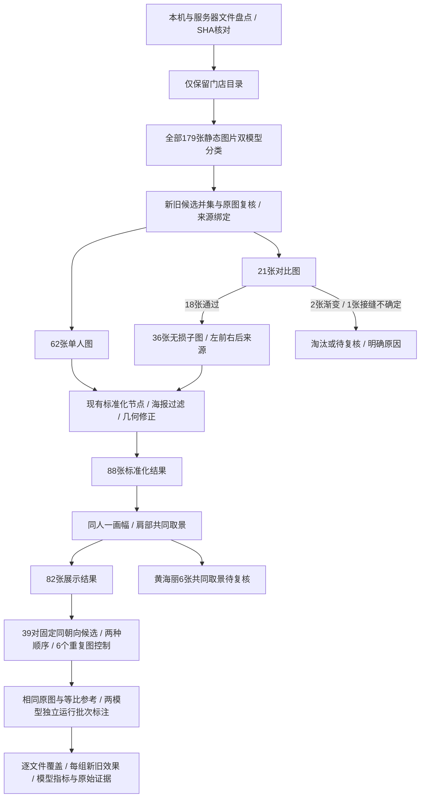

# 全量门店数据与视觉模型对比

2026-11-06。实现：[scripts/body_scan_full_eval](../../scripts/body_scan_full_eval/README.md)。本轮是完整数据覆盖与独立模型评测，不修改冻结最佳实践或生产模型设置。

## 最终目录范围

按用户补充要求，只处理 `景田店`、`石厦店`、`宝安店` 等 `xxx店` 顶层目录。`参考模板`、`参考模版`、`会员案例素材生产标准（说明文件）` 整目录排除，**模板内的原始素材也不参与**。同时检查路径和 store 元数据，不能因为模板样例的名称包含门店就放行。

本机 `Downloads/私教会员案例项目` 与服务器原上传包的 231 个业务文件 SHA256 多重集完全一致；无漏上传，也无额外文件。排除 `.DS_Store` 等系统元数据。最终范围：

| 数据 | 数量 |
| --- | ---: |
| 门店业务文件 | 194 |
| 门店静态图片，全部重新分类 | 179 |
| 门店视频／文档，保留并记录不进入静态图流程 | 15 |
| 参考模板与说明目录，整目录排除 | 37 |
| 门店会员组，包含无成品的组 | 18 |

初始盘点曾包含模板原始样例；用户收窄范围后另建 stores 实验，只复用匹配门店图片的分类/背景调用，重新生成派生 job、标准化和展示结果。初始宽范围结果不作为最终成品、模型分母或费用分母。

## 全量工作流

179 张中，83 张为体测图（62 单人 + 21 对比），96 张非体测。新旧分类合并有 84 个候选，其中潘艺文 `a0169` 经原图复核仍是开放器械区抬臂图，排除。海报保持在标准化节点筛除，不移到本轮的同组展示节点。

阶段计数不能直接相加：对比原文件与拆出的子图是不同单位。

| 阶段 | 成功 | 明确排除 | 待复核 |
| --- | ---: | ---: | ---: |
| 62 单人图标准化 | 59 | 1 海报 | 2 相机／肩部问题 |
| 21 对比原文件拆分 | 18，生成36子图 | 2 渐变 | 1 接缝判断冲突 |
| 36 子图标准化 | 29 | 2 海报 | 5 网格几何证据不足 |
| 88 张进入同组展示 | 82，16人组 | 0 | 6，同一人组共同取景冲突 |

所有 194 个门店文件都有最终去向；18 个人组都纳入覆盖统计。任胜男的三张对比图因渐变/接缝问题无成品；黄海丽整组待复核。不能把“全量已测试”描述为“所有照片均成功处理”。

## 与旧子集的效果差异

- 旧版 42 张，本轮 82 张：保留39张对应输入，新增43张，旧版黄海丽3张未进入本次成品。原历史结果完整保留。
- 黎国萍 `a0102/a0105/a0107` 黑衣三张已补齐，现为6张同框取景；这些文件一直在服务器上，旧版缺失是没有被选入验证范围。
- 黄海丽新增黑衣三张后，6张共用的有效上边界为 `-383.16`，保留已确认完整头部要求达到 `-412.16`，相差约29个归一化坐标单位。现有保护规则拒绝整组取景；未为了增加成功数量而截头或修改取景策略。
- 通过的82张均保持同一人的尺寸、肩部原点、裁剪和缩放一致；最大展示纵向相对拉伸约1.0836，小于1.1。等比参考不额外拉伸，模型只读取原图与等比参考。
- 新增数据会影响整组共同范围，所以同一原图的新旧取景未必字节一致。39张重合输入的原图均一致，其中29张等比参考也逐字节一致。

## 公平比较条件

接口实际返回模型名为 `deepseek-flash` 与用户提供的 `qwen3.8-max`。DeepSeek 当前官方别名映射为 DeepSeek-V4.1-Flash-1017；Qwen3.8-Max 官方支持视觉输入。[DeepSeek模型说明](https://api-docs.deepseek.com/quick_start/pricing/) · [Qwen模型说明](https://help.aliyun.com/en/model-studio/qwen3-8-max)

- 相同图片像素、相同提示词、相同JSON校验与采纳策略；temperature=0，max_tokens=3500，并发3。
- 图片最长边1280、JPEG质量92；两模型都关闭思考，使用各自接口参数。Qwen使用 `enable_thinking:false`，DeepSeek使用 `thinking:{type:disabled}`。
- 分类和背景审查独立比较。几何校正/取景共用现有处理结果，不把不同裁剪造成的体形差异混入模型对比。
- 复杂观察用固定39对同人同朝向候选，各问原顺序与交换顺序，共78个观察阶段；即使初次无方向也检查另一顺序。另加6对完全相同照片的负对照。
- 批次标注按各模型独立分组，使用同一82张输入；已成功的相同观察调用复用。按不同节点记录原始答复，失败尝试永久保留，不能只统计最后一次成功。
- 仅一次原顺序/换序试验，不凭语义不确定反复询问、投票或挑选较好答案。传输/JSON错误最多重试一次；字段不满足现有 schema 时不自动修补成采用结果。

## 结果

| 指标 | DeepSeek | Qwen3.8-Max |
| --- | ---: | ---: |
| 门店图片体测／非体测结论一致 | 两者179/179一致 | 两者179/179一致 |
| 七类素材分类彼此一致 | 两者172/179一致 | 两者172/179一致 |
| 单人62 + 子图36 的海报过滤 | 两者98/98决策一致，均识别3张海报 | 同左 |
| 固定78个复杂观察阶段结构校验通过 | 66/78 | 78/78 |
| 固定39对中保留换序一致方向 | 6/39 | 24/39 |
| 初次有方向的配对 | 19，其中6保持、7反向、3丢失方向、3换序答复无效 | 30，其中24保持、3反向、3丢失方向 |
| 相同照片负对照未虚构方向 | 6/6 | 5/6 |
| 最终82张中采用阶段标签 | 31 | 46 |
| 其中固定左右拆分规则 | 29 | 29 |
| 其中AI推断 | 2 | 17（16直接观察 + 1可靠同批继承） |
| 待复核 | 51 | 36 |
| 分类接口耗时 P50 / P95 | 1.439 / 1.826 秒 | 4.211 / 4.947 秒 |
| 实际评测HTTP尝试次数 | 429 | 403 |
| 输入 / 输出token | 797251 / 43910 | 988891 / 60239 |
| 本次范围的标准价估算 | USD 0.0905–0.1811，随峰谷价 | CNY 13.97 |

“稳定方向”包含仍需其他证据的轻微变化，不等于正式阶段标签，更不是准确率。没有独立人工阶段真值或已核实拍摄时间，不能以46比31多就断言Qwen更准确。

计费按接口usage及标准价：Qwen输入/隐式缓存输入/输出分别为每百万token人民币12/1.5/36；DeepSeek按命中缓存、未命中、输出及峰谷价分别估算。接口可能有账户折扣，人民币与美元没有使用未经核实的汇率转换。统计只包括门店双模型评测调用，含诊断背景探测；共同几何管线、连通性探测和范围收窄前的参考材料调用不计入差额。[Qwen计费](https://platform.qianwenai.com/docs/developer-guides/getting-started/model-prices) · [DeepSeek计费](https://api-docs.deepseek.com/quick_start/pricing/)

耗时为HTTP尝试墙钟时间的累计，包含网络传输，不含图片编码、缓存重放和重试退避；分类阶段两者都无重试。token不能当作相同信息量，两服务的视觉编码与缓存命中不同。

## 必须保留的反例与限制

1. **Qwen也会虚构变化。** 卢家俊 `a0085__p01` 原图/等比参考完全重复输入，模型仍声称B腰侧更收紧，自报0.85。输入哈希证实完全相同，换序规则拦下方向。正式阶段流程本来就跳过相同来源，不受该负对照影响。6个控制样本很小，不能把5/6外推为一般错误率。
2. **DeepSeek的输出结构错误需要单列。** 固定观察78个阶段中，9个最终未获得可解析JSON/返回结构，另3个是confidence/reason嵌套位置或观察字段集合不符合约定。完整调用历史另记录恢复尝试，HTTP 200不代表业务结构有效。
3. **何彦霖的变化不是缺图。** 本轮其4张原图和等比参考与旧版完全相同；DeepSeek正面对比的JSON字段结构未过校验，旧版4张采用标签变为待复核。Qwen本轮4张通过双向外观比较。不能把这一差异全部归因于补充了更多数据。
4. **黎国萍数据完整仍可待复核。** 黑衣/绿衣6张已进入统一取景；Qwen不同朝向的方向证据产生批次冲突，最终没有强行给出前后。这属于标签不确定，不能再归类为漏上传或漏处理。
5. **比较图不能整图只选一种背景。** 诊断时Qwen曾对蒲小东“左海报 + 右网格”的原拼图优先报告右侧网格；这不会替代生产过滤。先拆后逐子图检查时，两模型均识别并排除了左侧海报。
6. **左右侧标签仍有分歧。** 本轮没有建立独立的解剖左右真值，不能以更少输出side或更高置信度判断哪个更准。前后节点继续将侧面作为候选，再验证同侧与姿势。

建议：基础素材分类和海报筛选继续使用更快的DeepSeek；复杂前后观察优先试用Qwen，并保留固定来源标签、重复检测、换序验证、批次冲突及待复核出口。本轮不直接替换全站模型，不放宽保护规则来提高采用数量。

## 产物与校验

最终远程目录：

`/root/autodl-fs/case-studio/experiments/body-scan-full-model-eval-stores-v1-20261106`

入口 `index.html`；子目录 `display`、`phase-deepseek`、`phase-qwen`；`coverage.json` 是逐文件去向，`model-comparison.json` 是详细对比，`observations-*/summary.json` 保存固定配对原始证据。

本机查看目录：

`/Users/zhangming/Projects/FP16-Speed/artifacts/body-scan-full-model-eval-stores-v1`

远程验证：8项新测试 + 33项v2 + 20项v1回归，共61项通过；新成品源像素、矩形覆盖、同人同规格及164张派生图验证通过；两模型82张输入的ID、原图和等比参考SHA完全相同，固定规则标签均未被覆盖。原94个阶段输入指纹和137个旧成品/预览未变，最终231个原始业务文件仍与本机匹配。
