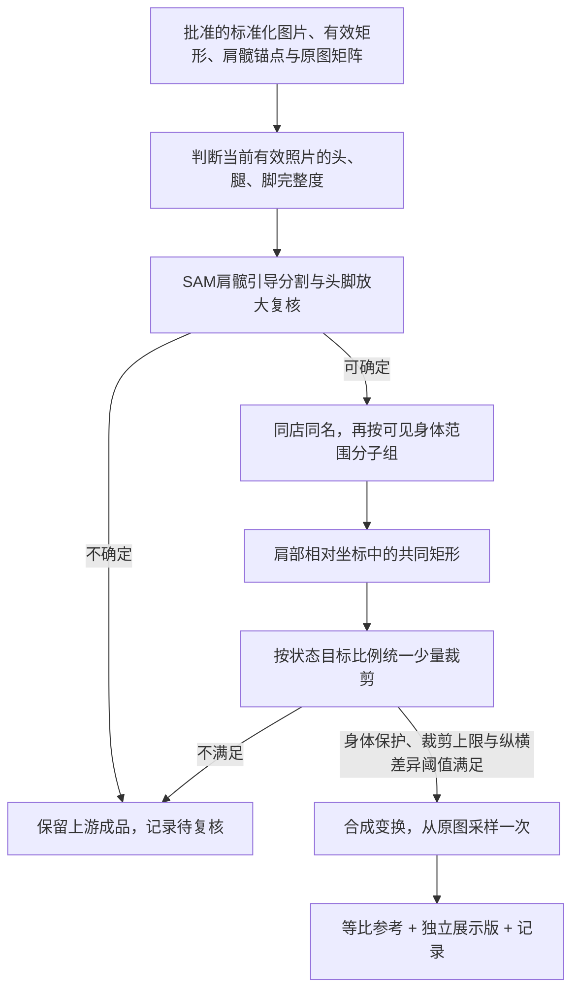

# 标准化之后：同组统一取景与展示版

记录日期：2026-11-05。状态：独立脚本已实现并在远程验证，尚未接入网站或统一工作流编排。

入口：[scripts/body_scan_group_display](../../scripts/body_scan_group_display/README.md)。本轮未修改冻结最佳实践。

实现版本：`body-scan-group-display-v1`；对应提交：`b1e5fa8b08708bbfc67b00f07901d77874841461`。本文记录该版本实际执行的过程及验证结果；在整体流程中的位置见[体测图处理工作流](body-scan-processing.md)。

## 需求落点

现有标准化画布尺寸相同，但内部真实有效照片矩形仍有差异。新节点在批准的标准化结果之后处理，不再估计镜头参数，不重新拆分拼图。



## 实际执行顺序

| 步骤 | 当前实现的处理 | 输出或停止条件 |
| --- | --- | --- |
| 1. 接收标准化结果 | 读取一个或多个结果目录，检查来源SHA、上游状态、有效矩形与坐标变换 | 仅接收 `rectangular`；其他项记为 `upstream_excluded`，保留原原因 |
| 2. 判断身体完整度 | 去掉画布补边，把真实有效照片交给视觉模型，记录头部、下肢、肩髋可见性及主体粗框 | 完整度不确定、置信度不足或肩髋不可见则 `needs_review`；贴纸、发型、背面不直接等于缺头 |
| 3. 检查贴边证据 | 对完整脚部、或头部靠近上边界的候选，用批准的肩髋点引导SAM；从满足主体约束的候选中按置信度选轮廓 | 不使用最大轮廓面积直接决定主体，避免背景海报干扰 |
| 4. 放大复核 | 可靠轮廓接触边界，或分割不可靠时，把完整照片、顶部28%和底部30%局部交给模型复核 | 分别保留语义结论与贴边证据；贴边记为 `touching_border` / `feet_touching_border`，不伪装为确认缺失；复核不确定则停止该图 |
| 5. 同人分子组 | 按同店同名归组，再按当前可见身体范围选择profile | 一张半身照不会成为整组全身照的最低取景高度；同一人可以有多个展示子组 |
| 6. 建立共同取景框 | 沿用批准肩髋尺度与肩部锚点，在肩部相对坐标中求有效矩形的交集 | 同子组采用一个共同矩形，保留肩髋、已确认完整的头和脚；没有可行共同矩形则停止该子组 |
| 7. 匹配目标比例 | 按profile选画幅，求满足纵横差异上限的最少额外裁剪，并记录小步裁剪路径 | 超过裁剪上限、步数上限或身体保护条件则待复核；不靠反复重采样尝试比例 |
| 8. 渲染与验证 | 合成上游变换、共同裁剪和缩放矩阵，从原始单图分别采样得到等比参考与展示版 | 检查矩形没有缺失像素、同子组参数一致、比例未超限、原图及上游成品SHA不变，再写预览和下载包 |

这里的“原始单图”对拆分素材指拆分后的无损子图；取样范围仍属于该子图，不跨到原拼图的另一侧。

## 关键规则

- **判断范围**：只判断当前有效照片，包括前序取景造成的缺失；不得反推原始拍摄时没有头/脚。
- **同组同框**：同一会员下，全身、脚部贴边/缺失、头部缺失、腿部缺失、上半身等状态分别处理。同一子组共用裁剪和缩放参数；不同状态不要求画幅一致。
- **肩部基准**：复用批准版肩髋尺度。真实抬臂姿势复用批准的中立肩部参照，不用发型、贴纸或侧面肩宽重新定标。
- **有效矩形**：求肩部相对坐标的共同交集，不是只取最小宽高再居中。所有展示像素都来自已批准照片矩形，保留可见肩髋及已确认完整的头/脚；无法满足则待复核。
- **缩放方向**：用户允许轻微非等比调整，仅另存展示版。额外纵向缩放相对于横向为 `1.0～1.1`，同一子组一致，不把某一张单独拉瘦或把侧身拉到正面同宽。
- **阈值解释**：`1.1` 限制 `scale_y/scale_x`，不是绝对像素放大。裁小后填满相同画布会增加绝对放大倍数，因此“裁小直到绝对放大不超限”无法成立。
- **有限裁剪**：直接解出满足目标比例和拉伸阈值的最小额外裁剪，记录每步最多 2% 的路径；默认共同矩形额外面积损失最多 25%、最多 80 步。只渲染最终一次。
- **边界可信度**：SAM用肩髋前景点选主体，边缘接触还需放大复核。`touching_border` 是贴边证据，不等于确认缺失；背景海报不能直接作为人物轮廓证据。

## 当前画幅与共同裁剪算法

默认宽768。不同完整度使用以下画幅；同一子组共用尺寸、取景位置和缩放，不能逐张调成不同的体形比例。

| profile | 当前照片状态 | 默认宽×高 |
| --- | --- | --- |
| `full_body` | 全身完整 | 768×1920 |
| `feet_cropped` | 头和腿可见，脚部贴边或不完整 | 768×1792 |
| `head_cropped` | 头部贴边或不完整，腿脚完整 | 768×1664 |
| `head_feet_cropped` | 头脚贴边或不完整，腿部可见 | 768×1536 |
| `legs_cropped` | 头完整，底边在小腿或膝附近 | 768×1408 |
| `head_legs_cropped` | 头贴边或不完整，底边在小腿或膝附近 | 768×1184 |
| `upper_body` | 头完整，底边在大腿或髋附近 | 768×1152 |
| `torso` | 头贴边或不完整，底边在大腿或髋附近 | 768×1024 |

各图有效矩形先转换到共同肩部基准，设它们的边界为 `(left_i, top_i, right_i, bottom_i)`，共同矩形为：

```text
left   = max(left_i)
top    = max(top_i)
right  = min(right_i)
bottom = min(bottom_i)
```

这是“统一最小取景”在肩部对齐条件下的实现。直接取最小宽高不能保证肩部两侧及上下仍有足够内容。

设共同矩形为 `w×h`，目标画幅高宽比为 `r`，纵横差异上限为 `k=1.1`：

| 当前高宽比 | 共同调整 | 最终效果 |
| --- | --- | --- |
| `h/w < r/k` | 宽度缩至 `h×k/r`，高度保持 | 纵向相对缩放刚好达到上限 `k` |
| `r/k ≤ h/w ≤ r` | 不额外裁剪 | 纵向相对缩放处于 `1～k` |
| `h/w > r` | 高度缩至 `w×r`，宽度保持 | 使用等比缩放，避免横向拉宽 |

调整后仍须找到能够保留身体保护区域的裁剪位置。每步最多缩减当前宽/高的2%，最多80步；额外面积损失上限25%以**已经求出的共同矩形**为基准，不包括各图收缩到共同交集时的损失。计算出最终框后只渲染一次。

默认画幅和肩部位置可通过 `--profiles` 调整，分辨率可通过 `--width` 调整，纵横差异上限用 `--max-stretch` 设置。所有参数写入本次运行配置。

## 节点接口与交付

输入为一个或多个批准的单图结果目录，包含 `summary.json`、配置、原图来源、`aligned.png`、`content_mask.png` 和几何信息。硬拼接的合格子图通过单图最佳实践后也可输入。

输出三份图：原标准化的逐字节副本、共同取景的等比参考、填满目标矩形的展示版。展示版附带 `presentation_only` 标记，不用于真实体形测量。记录输入 SHA、分类及边界证据、子组、共同矩形、裁剪路径、拉伸比例、父级坐标变换、成品 SHA 和复核原因。

原图、批准标准化结果及最佳实践副本保留。节点失败不会推翻上游成功状态。验证范围、样本结果和运行路径见 [validation.json](../../scripts/body_scan_group_display/validation.json)；可调整尺寸及阈值见脚本 README。

成功产物位于 `images/<asset_id>/`：`baseline.png` 为标准化原版副本，`uniform.png` 为等比参考，`display.png` 为展示版。组级规划写入 `groups.json`，逐图记录写入 `summary.json` 与 `reports/`，自动校验写入 `verification.json`。`index.html`、`previews/` 和ZIP用于审阅和下载。

只要分类或规划不能确定，就记录 `needs_review`，不给该图生成成功标记；子组规划失败影响该子组，单张渲染失败只影响该图。上游全部未放行时也输出空结果报告，保留排除原因。

## 远程验证与复现

2026-11-05的实际输入为单图v3结果，以及硬拼接拆分并标准化后的子图结果。远程输出目录：

```text
/root/autodl-fs/case-studio/experiments/body-scan-group-display-v1-validated-20261105
```

| 项目 | 实际结果 |
| --- | --- |
| 处理范围 | 11个同人组，16个身体状态子组；43张合格输入，另有5张上游未放行 |
| 展示结果 | 42张成功，1张待复核；生成42份原标准化副本和84张衍生图 |
| 缩放范围 | 最大纵向/横向缩放比 `1.0835978836`，约额外纵向调整8.36%，低于1.1上限 |
| 自动验证 | 24项测试通过；43张来源校验、42份原版副本及84张衍生图的几何/尺寸/像素有效性校验通过 |
| 视觉证据 | 43次初始完整度分类、19次边界放大复核；最终验证运行复用先前实际模型响应，新增请求0次 |
| 已有特殊姿势 | `a0101`继续使用上游批准的中立肩部锚点 |
| 待复核 | 蒲小东 `a0034`：有效区域偏窄，目标画幅会裁到已确认完整的脚部；原因 `target_aspect_would_cut_required_body` |

结果不代表所有照片都能自动满足目标画幅。当前待复核项保留上游标准化结果，不强行裁脚，也不自动放宽展示参数。

在服务器上复现时使用新的输出目录：

```bash
cd /root/apps/case-studio
scripts/body_scan_group_display/run.sh \
  --input /root/autodl-fs/case-studio/experiments/body-scan-wall-v3-20261105 \
          /root/autodl-fs/case-studio/experiments/body-scan-pairs-hard-v1-20261105-final/aligned \
  --out /root/autodl-fs/case-studio/experiments/NEW-group-display \
  --max-stretch 1.1
```

入口默认使用远程 `/root/apps/non-grid-calibration/.venv/bin/python`。允许以 `--audit` 复用输入指纹一致且包含当前边界证据的完整度审查；不会直接信任来自其他输入或旧边界策略的记录。此命令只运行同组展示节点，整条工作流调度仍待实现。
