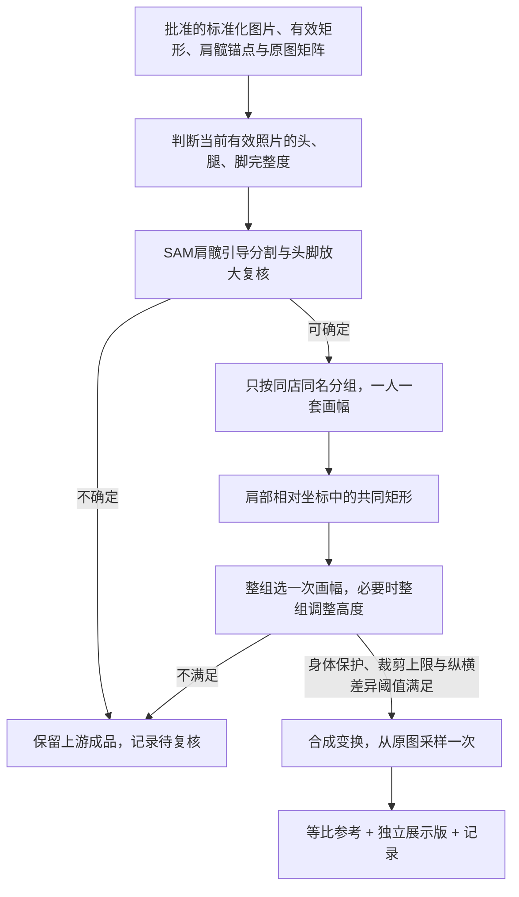

# 标准化之后：一人一画幅的统一取景与展示版

记录日期：2026-11-05。状态：独立脚本已实现并在远程验证，尚未接入网站或统一工作流编排。

入口：[scripts/body_scan_group_display](../../scripts/body_scan_group_display/README.md)。本轮未修改冻结最佳实践。

当前实现版本：`body-scan-group-display-v2`。用户明确要求同一个人物不得构建多种比例，因此v1按完整度拆子组的规则已取消。v1来源提交 `b1e5fa8` 和旧实验结果保留作历史；本页以v2为准。整体流程见[体测图处理工作流](body-scan-processing.md)。

## 需求落点

现有标准化画布尺寸相同，但内部真实有效照片矩形仍有差异。新节点在批准的标准化结果之后处理，不再估计镜头参数，不重新拆分拼图。

**同店同名只形成一个展示组，所有合格照片共用一种输出比例、尺寸、取景框、缩放和肩部位置。** 完整度作为逐图标签及整组取景依据，不能再用于拆出多个输出画幅。全身与半身混合时按整组共同可见范围取景，便于后续直接拼接。



## 实际执行顺序

| 步骤 | 当前实现的处理 | 输出或停止条件 |
| --- | --- | --- |
| 1. 接收标准化结果 | 读取一个或多个结果目录，检查来源SHA、上游状态、有效矩形与坐标变换 | 仅接收 `rectangular`；其他项记为 `upstream_excluded`，保留原原因 |
| 2. 判断身体完整度 | 去掉画布补边，把真实有效照片交给视觉模型，记录头部、下肢、肩髋可见性及主体粗框 | 完整度不确定、置信度不足或肩髋不可见则 `needs_review`；贴纸、发型、背面不直接等于缺头 |
| 3. 检查贴边证据 | 对完整脚部、或头部靠近上边界的候选，用批准的肩髋点引导SAM；从满足主体约束的候选中按置信度选轮廓 | 不使用最大轮廓面积直接决定主体，避免背景海报干扰 |
| 4. 放大复核 | 可靠轮廓接触边界，或分割不可靠时，把完整照片、顶部28%和底部30%局部交给模型复核 | 分别保留语义结论与贴边证据；贴边记为 `touching_border` / `feet_touching_border`，不伪装为确认缺失；复核不确定则停止该图 |
| 5. 同人统一分组 | 只按同店同名分组，从整组头部共同条件和最受限的下肢范围选择一次首选profile | 同一人只有一种画幅；全身与半身混合时完整图也使用共同取景范围，原始完整度标签保留 |
| 6. 建立共同取景框 | 沿用批准肩髋尺度与肩部锚点，在肩部相对坐标中求整组有效矩形的交集 | 保护肩髋及共同矩形内仍能保留的身体上下范围；整组均确认完整的头/脚继续完整保护；无可行共同矩形则整组待复核 |
| 7. 匹配整组比例 | 先尝试整组首选模板；不满足保护、裁剪或步数条件时，计算可行高度区间，整组统一取最接近首选值的高度 | 不放宽纵横差异与裁剪阈值，不为个别图换规格；仍无可行比例则整组待复核 |
| 8. 渲染与验证 | 合成上游变换、共同裁剪和缩放矩阵，从原始单图分别采样得到等比参考与展示版 | 明确检查一人只能有一个画幅及一套取景/缩放/肩部参数，另检查矩形有效、比例未超限、来源SHA不变，再写预览和下载包 |

这里的“原始单图”对拆分素材指拆分后的无损子图；取样范围仍属于该子图，不跨到原拼图的另一侧。

## 关键规则

- **判断范围**：只判断当前有效照片，包括前序取景造成的缺失；不得反推原始拍摄时没有头/脚。
- **一人一画幅**：同一会员的所有合格照片共用尺寸、裁剪和缩放，不按完整度拆组。不同会员之间可选不同画幅。同一个人的全身与半身混合时按共同可见范围统一，完整图可能随组裁去部分身体。
- **肩部基准**：复用批准版肩髋尺度。真实抬臂姿势复用批准的中立肩部参照，不用发型、贴纸或侧面肩宽重新定标。
- **有效矩形**：求肩部相对坐标的共同交集，不是只取最小宽高再居中。所有展示像素来自已批准照片矩形。额外比例调整保护共同矩形内可保留的身体上下范围，避免仅因一张贴纸贴边而把整组头部继续裁掉。
- **缩放方向**：用户允许轻微非等比调整，仅另存展示版。额外纵向缩放相对于横向为 `1.0～1.1`，同人整组一致，不把某一张单独拉瘦或把侧身拉到正面同宽。
- **阈值解释**：`1.1` 限制 `scale_y/scale_x`，不是绝对像素放大。裁小后填满相同画布会增加绝对放大倍数，因此“裁小直到绝对放大不超限”无法成立。
- **有限裁剪**：直接解出满足目标比例和拉伸阈值的最小额外裁剪，记录每步最多 2% 的路径；默认共同矩形额外面积损失最多 25%、最多 80 步。只渲染最终一次。
- **边界可信度**：SAM用肩髋前景点选主体，边缘接触还需放大复核。`touching_border` 是贴边证据，不等于确认缺失；背景海报不能直接作为人物轮廓证据。

## 当前画幅与共同裁剪算法

默认宽768。下表是根据**整组共同完整度**选择一次的首选模板，不是逐张构建的输出规格。实际高度可能因共同区域和身体保护而整组调整；最终尺寸以组级 `output_size` 为准，所有图共用取景位置和缩放。

| 整组首选profile | 整组共同状态 | 首选宽×高 |
| --- | --- | --- |
| `full_body` | 全身完整 | 768×1920 |
| `feet_cropped` | 头和腿可见，脚部贴边或不完整 | 768×1792 |
| `head_cropped` | 头部贴边或不完整，腿脚完整 | 768×1664 |
| `head_feet_cropped` | 头脚贴边或不完整，腿部可见 | 768×1536 |
| `legs_cropped` | 头完整，底边在小腿或膝附近 | 768×1408 |
| `head_legs_cropped` | 头贴边或不完整，底边在小腿或膝附近 | 768×1184 |
| `upper_body` | 头完整，底边在大腿或髋附近 | 768×1152 |
| `torso` | 头贴边或不完整，底边在大腿或髋附近 | 768×1024 |

各图有效矩形先转换到共同肩部基准，设它们的边界为 `(left_i, top_i, right_i, bottom_i)`，共同矩形为：

```text
left   = max(left_i)
top    = max(top_i)
right  = min(right_i)
bottom = min(bottom_i)
```

这是“统一最小取景”在肩部对齐条件下的实现。直接取最小宽高不能保证肩部两侧及上下仍有足够内容。

设共同矩形为 `w×h`，目标画幅高宽比为 `r`，纵横差异上限为 `k=1.1`：

| 当前高宽比 | 共同调整 | 最终效果 |
| --- | --- | --- |
| `h/w < r/k` | 宽度缩至 `h×k/r`，高度保持 | 纵向相对缩放刚好达到上限 `k` |
| `r/k ≤ h/w ≤ r` | 不额外裁剪 | 纵向相对缩放处于 `1～k` |
| `h/w > r` | 高度缩至 `w×r`，宽度保持 | 使用等比缩放，避免横向拉宽 |

调整后仍须找到能够保留身体保护区域的裁剪位置。每步最多缩减当前宽/高的2%，最多80步；额外面积损失上限25%以**已经求出的共同矩形**为基准，不包括各图收缩到共同交集时的损失。计算出最终框后只渲染一次。

首选比例不满足上述条件时，设保护区域宽高为 `rw×rh`、实际允许额外裁剪比例为 `L=min(25%, 1-(1-2%)^80)`，可行高宽比区间为：

```text
r_min = max(0.5, rh/w, (1-L)×h/w)
r_max = min(4, k×h/max(rw, (1-L)×w))
```

据此得到整数输出高度范围（同时限定为256～6144），取最接近首选高度的可行值，再检查最终矩形。该调整作用于整个人物组，并记录首选尺寸、实际尺寸和原因，不新增第二套画幅。保护区域始终包含肩髋以及共同矩形内可保留的身体上下范围；整组都完整的头/脚还须完全保留。

首选画幅和肩部位置可通过 `--profiles` 调整，分辨率可通过 `--width` 调整，纵横差异上限用 `--max-stretch` 设置。`--fixed-group-ratio`可禁止自动调整整组高度，此时模板放不下就整组待复核。所有参数写入本次运行配置。

## 节点接口与交付

输入为一个或多个批准的单图结果目录，包含 `summary.json`、配置、原图来源、`aligned.png`、`content_mask.png` 和几何信息。硬拼接的合格子图通过单图最佳实践后也可输入。

输出三份图：原标准化的逐字节副本、共同取景的等比参考、填满目标矩形的展示版。展示版附带 `presentation_only` 标记，不用于真实体形测量。记录输入SHA、逐图分类及边界证据、同人组、共同矩形、首选及实际尺寸、裁剪路径、拉伸比例、坐标变换、成品SHA和复核原因。

原图、批准标准化结果及最佳实践副本保留。节点失败不会推翻上游成功状态。验证范围、样本结果和运行路径见 [validation.json](../../scripts/body_scan_group_display/validation.json)；可调整尺寸及阈值见脚本 README。

成功产物位于 `images/<asset_id>/`：`baseline.png` 为标准化原版副本，`uniform.png` 为等比参考，`display.png` 为展示版。组级规划写入 `groups.json`，逐图记录写入 `summary.json` 与 `reports/`，自动校验写入 `verification.json`。`index.html`、`previews/` 和ZIP用于审阅和下载。

`groups.json`为兼容已有预览保留 `cohorts` 字段，但每个人最多一个，ID为 `gNNN__shared`。逐图 `profile`只描述输入完整度，`display_profile`描述整组首选模板；不能把逐图标签重新当成分组键。`originally_complete_parts_cropped`记录完整图为共同取景让出的头/脚范围。

分类不确定只停止该图；整组规划失败使该组待复核，不通过拆组绕开；单张渲染失败只影响该图，其他合格成品仍使用同一组参数。上游全部未放行时也输出空结果报告，保留排除原因。

## 远程验证与复现

2026-11-05的实际输入为单图v3结果，以及硬拼接拆分并标准化后的子图结果。远程输出目录：

```text
/root/autodl-fs/case-studio/experiments/body-scan-group-display-v2-validated-20261105
```

| 项目 | 实际结果 |
| --- | --- |
| 处理范围 | 11个同人组、恰好11套画幅；43张合格输入，另有5张上游未放行 |
| 展示结果 | 43张全部成功；生成43份原标准化副本和86张衍生图 |
| 缩放范围 | 最大纵向/横向缩放比 `1.0835978836`，约额外纵向调整8.36%，低于1.1上限 |
| 自动验证 | 32项测试通过；43张来源、43份原版副本及86张衍生图校验通过；另验证每个人只有一种尺寸、一套取景/缩放/肩部参数 |
| 视觉证据 | 复用v1已完成的43张完整度分类及19次边界复核audit，输入指纹匹配；本次新增模型请求0次 |
| 已有特殊姿势 | `a0101`继续使用上游批准的中立肩部锚点 |
| 混合完整度示例 | 潘艺文6张全部768×1792；何彦霖4张全部768×1024；吴显昉4张全部768×1131 |
| 窄画幅示例 | 蒲小东两张共同使用768×2167，保留共同区域内的身体范围；a0034本次通过 |

本批全部通过不代表任意输入都可处理。共同矩形无法保留必要范围或无可行统一比例时仍整组待复核；v1实验目录中的旧结果保持原样。

在服务器上复现时使用新的输出目录：

```bash
cd /root/apps/case-studio
scripts/body_scan_group_display/run.sh \
  --input /root/autodl-fs/case-studio/experiments/body-scan-wall-v3-20261105 \
          /root/autodl-fs/case-studio/experiments/body-scan-pairs-hard-v1-20261105-final/aligned \
  --out /root/autodl-fs/case-studio/experiments/NEW-group-display \
  --max-stretch 1.1
```

入口默认使用远程 `/root/apps/non-grid-calibration/.venv/bin/python`。允许以 `--audit` 复用输入指纹一致且包含当前边界证据的完整度审查；不会直接信任来自其他输入或旧边界策略的记录。此命令只运行同组展示节点，整条工作流调度仍待实现。
