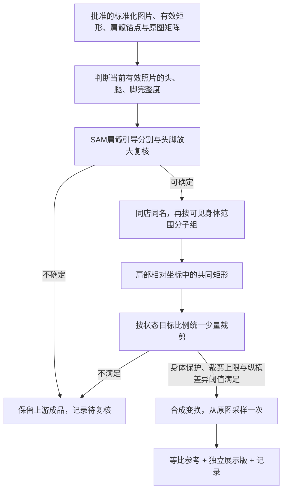

# 标准化之后：同组统一取景与展示版

记录日期：2026-11-05。状态：独立脚本已实现并在远程验证，尚未接入网站或统一工作流编排。

入口：[scripts/body_scan_group_display](../../scripts/body_scan_group_display/README.md)。本轮未修改冻结最佳实践。

## 需求落点

现有标准化画布尺寸相同，但内部真实有效照片矩形仍有差异。新节点在批准的标准化结果之后处理，不再估计镜头参数，不重新拆分拼图。

## 关键规则

- **判断范围**：只判断当前有效照片，包括前序取景造成的缺失；不得反推原始拍摄时没有头/脚。
- **同组同框**：同一会员下，全身、脚部贴边/缺失、头部缺失、腿部缺失、上半身等状态分别处理。同一子组共用裁剪和缩放参数；不同状态不要求画幅一致。
- **肩部基准**：复用批准版肩髋尺度。真实抬臂姿势复用批准的中立肩部参照，不用发型、贴纸或侧面肩宽重新定标。
- **有效矩形**：求肩部相对坐标的共同交集，不是只取最小宽高再居中。所有展示像素都来自已批准照片矩形，保留可见肩髋及已确认完整的头/脚；无法满足则待复核。
- **缩放方向**：用户允许轻微非等比调整，仅另存展示版。额外纵向缩放相对于横向为 `1.0～1.1`，同一子组一致，不把某一张单独拉瘦或把侧身拉到正面同宽。
- **阈值解释**：`1.1` 限制 `scale_y/scale_x`，不是绝对像素放大。裁小后填满相同画布会增加绝对放大倍数，因此“裁小直到绝对放大不超限”无法成立。
- **有限裁剪**：直接解出满足目标比例和拉伸阈值的最小额外裁剪，记录每步最多 2% 的路径；默认共同矩形额外面积损失最多 25%、最多 80 步。只渲染最终一次。
- **边界可信度**：SAM用肩髋前景点选主体，边缘接触还需放大复核。`touching_border` 是贴边证据，不等于确认缺失；背景海报不能直接作为人物轮廓证据。

## 节点接口与交付

输入为一个或多个批准的单图结果目录，包含 `summary.json`、配置、原图来源、`aligned.png`、`content_mask.png` 和几何信息。硬拼接的合格子图通过单图最佳实践后也可输入。

输出三份图：原标准化的逐字节副本、共同取景的等比参考、填满目标矩形的展示版。展示版附带 `presentation_only` 标记，不用于真实体形测量。记录输入 SHA、分类及边界证据、子组、共同矩形、裁剪路径、拉伸比例、父级坐标变换、成品 SHA 和复核原因。

原图、批准标准化结果及最佳实践副本保留。节点失败不会推翻上游成功状态。验证范围、样本结果和运行路径见 [validation.json](../../scripts/body_scan_group_display/validation.json)；可调整尺寸及阈值见脚本 README。
