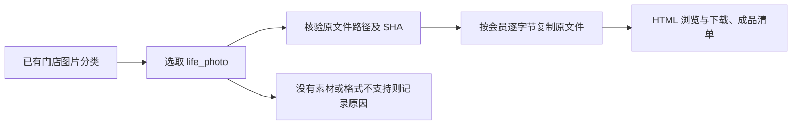

# 生活照原图成品

2026-11-07：用户要求筛选后的生活照直接作为成品。生活照前后对比已取消；本节点不依赖训练阶段分类，也不做新的图像处理或筛选评分。

1. 复用已有 Qwen 分类，缺少该结果时回退 DeepSeek / 旧分类；只处理 `xxx店`，排除参考模板、说明文件、明确参考素材。
2. 所有已筛选 `life_photo` 图片均输出，不添加质量阈值或每会员数量限制，不比较胖瘦、不推断训练前后。
3. 原文件直接复制，保留格式、尺寸、EXIF、像素、原有贴纸与遮挡；不裁剪、缩放、调色、加框或做拼图。HTML 使用响应式展示，下载仍为原文件。
4. 读取来源 SHA 后校验输出 SHA，保留资产编号、会员目录、分类提供方及理由。错误的来源绑定或缺失文件应报错；不能静默漏图。已有输出目录不可覆盖。
5. 输出每会员图片、`results.json`、`review.json`、`sources.json`、`counts.json`、`bundle.json` 和 HTML。没有生活照的会员保留缺素材原因。协议为 `life-photo-originals-v1`，0 次模型调用。

权威入口：[life_photos/run.sh](../../best-practices/body-scan-delivery/life_photos/README.md)，作为成品目录第八类与训练日常等七类并列维护。根 `create` / `restyle` 尚不自动编排此节点。

全量分类中 179 张门店图片 → 19 张生活照，覆盖 12 位会员；另 6 组没有生活照。验收见 [validation.json](../../best-practices/body-scan-delivery/life_photos/validation.json)，预览在工作区 `artifacts/life-photos-v1/validated/index.html`。
