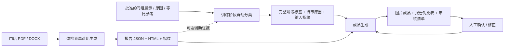

# 体检表对比、阶段分类、成品生成：三个独立节点

2026-11-06：按用户要求拆开处理职责，并将前两个节点归档为最佳实践。当前批准的图片、视觉提示词、阶段采用规则和成品图片模板保持原样。

## 职责与契约

| 节点 | 输入 | 输出 | 边界 |
| --- | --- | --- | --- |
| 体检表单对比生成 | `xxx店/会员/...` 原始报告，可选既有转录答复 | `body-report-comparison-v1` bundle：reports.json、inventory.json、index.html | 无须合格照片组；只按明确前后列转录、核验和计算，不推断照片阶段 |
| 训练阶段自动分类 | 批准同组展示，原图/等比参考，可选报告 bundle | `body-scan-phase-labels-v1` bundle：labels.json、inputs.json、report-link.json | 不解析 PDF/DOCX，不生成成品；负责全部标签补齐和报告变化的解释 |
| 成品生成 | 完整分类 bundle、绑定的报告 bundle、字体 | 版本化图片、报告 HTML/JSON、result.json、review.json、ZIP | 无模型参数、无上游算法导入；不接受未知标签，不在渲染时补猜 |

报告包是可独立搬运的数据，消费方不需要报告原文件或提取代码。分类包包含照片路径和指纹，生成前重新校验文件；报告包指纹也与分类时输入绑定，禁止分析用一版、展示另一版。报告变化后应重新执行分类；只改产品排版不需要重新分类。

报告检查原始列头、单元格、前后日期、单位、数值范围及 BMI/变化量一致性。保留原填数据与核验原因，不用“数值更好”猜列顺序。未匹配照片的报告仍可单独生成；归属/列头无法核验则进入待审清单。报告日期不自动绑定照片日期。

分类保持固定规则、明确文字和既有视觉推断。其余项在可靠批次/不同原图配对约束下按支持分排序；支持不足保留待审、无分数不造置信度。所有图有 before/after，但 `inferred` 和 `pending` 分别显示“（推断）”“（待审）”，同时返回审核标记，不能宣称为已证实拍摄顺序。人工修正须确认并绑定具体素材 SHA，优先于模型结论。

## 入口

1. [体检表对比最佳实践](../../best-practices/body-report-compare/README.md)：`run.sh --input RAW --out REPORTS --settings SETTINGS --cache CACHE`。
2. [训练阶段分类最佳实践](../../best-practices/body-scan-phase-classification/README.md)：`run.sh run --input DISPLAY --reports REPORTS --out PHASES --settings SETTINGS --cache CACHE`。
3. [成品生成](../../scripts/body_scan_delivery/README.md)：`python -m scripts.body_scan_delivery create --phase PHASES/classification --out DELIVERY --font FONT`。

参数是示意路径，真实图片/模型运行在远程服务器。可省略第二步 `--reports`；第一步可独立运行。三个输出目录都必须是新目录。冻结入口清空开发 PYTHONPATH 并检查清单，两个新增最佳实践互不导入。

分类 `finalize --analysis ANALYSIS --reports REPORTS --out LABELS` 用于既有视觉分析迁移或补齐标签；报告内容/覆盖须与分析一致，不会偷偷重新读取报告。`--settings/--cache` 可指定已有排序缓存，保证拆分前后可复现。原分析 CLI 的 `--reports` 现改为标准报告 bundle，原始文档根目录会被拒绝。旧 HTML 导出命令保留为兼容入口。

## 成品与人工复核

`result.report_comparison` 返回报告预览、结构化数据、来源 bundle SHA、存在核验问题的报告 ID。报告 HTML/JSON 作为独立成品进入 ZIP；本次没有新增报告图片模板。体测图片模板继续为单图、同朝向 VS、完整正/侧/背两排图。

图片的推断/待审项仍通过 `review.json` 和 `/api/productions/{id}/review` 复核。仅用户明确修改或确认的图片变为 human，重新渲染受影响图片，复用其他成品；旧版本不覆盖。该路径不调用表单提取或阶段分类。表单异常在报告对比表中单列；当前没有把“修改表格值”混入照片阶段审核 API。

6008网站保留现有登录与审核入口；上游 ZIP → 拆分 → 标准化 → 分组展示的完整自动调度仍未接通。本次完成可独立执行、通过数据契约串联的三节点，不宣称已实现整站自动调度。

## 验收

远程验证记录随本轮归档于两个最佳实践的 `validation.json` 和 `scripts/body_scan_delivery/validation-decoupling.json`。包括全量 82 张覆盖、原有标签/成品回归、无上游依赖的渲染及复核、两个冻结包独立启动。此前的实验文档保留历史计数，以本页的新职责划分为准。

本轮验收结果：147 项开发测试、30 项冻结节点测试通过。两个新快照从独立入口执行，完整性篡改会被拒绝；没有报告和历史基线的 5 张规则图也可独立分类。82 张最终标签逐字段相同，130 张图片成品 SHA 全同。模拟人工确认两张照片后重生成 5 张、复用 125 张，既有生产目录 236 个文件未变。

报告扫描 5 份门店文档、排除 3 份参考/说明文档。4 份核验通过，保留 32 项指标；另一份 candy 报告因门店/姓名原文归属不一致而待审，现有独立提取记录。冻结版报告 JSON/HTML 指纹与开发版一致；分类复用 95 个视觉阶段缓存和原排序缓存，无新增分类请求。6008 服务重启后健康检查、登录、生产列表与审核页正常。

## 现有成品的样式预览

准备调整版式时，使用 [body_scan_gallery](../../scripts/body_scan_gallery/README.md) 直接读取既有成品版本，生成离线 HTML。按门店/会员筛选，分为完整三视图、同朝向对比、单图三个类别；每套各类别绑定同一组六张素材。该入口仅复制并校验图片，不调用生成器或前面的处理节点。

当前样式基线包含 9 套完整案例、90 张既有成品，默认展示景田店／董彦琦。远程目录为 `/root/autodl-fs/case-studio/experiments/body-scan-three-view-style-v1-20261106`；本机预览为 `/Users/zhangming/Projects/FP16-Speed/artifacts/body-scan-three-view-style-v1/index.html`。生成模板和五个最佳实践均未修改。验证记录包括全部图片指纹、离线包，以及 9 套案例的分类/筛选/放大目标等 DOM 检查；本轮内置浏览器阻止本地 file URL，因此未做浏览器视觉验收。

### 三视图无缝版 v2

按用户后续要求，完整三视图去掉所有生成文字、红色标签条及拼接间隔。现将六张已批准展示图按原尺寸直接拼接为 3 列、2 行的无损 PNG，不再强制套入 1080×1440 画布。每组尺寸必须一致；拼图尺寸为三倍单图宽、两倍单图高，顺序沿用上前下后、每排正/侧/背。原图中已有的图像内容保留，阶段审核信息仍在 JSON 和页面中返回。

执行 `scripts.body_scan_delivery.restyle` 可复用既有标签和图片，只重绘成品。此次 9 张三视图重绘、121 张其他成品原样复用，原有 130 张成品和 82 张标签均未修改；35 项测试通过，核验器逐像素确认六个区域与输入帧完全一致。三视图渲染版本及缓存独立升级，旧红条图片不会误用；只确认阶段而未改变六张素材时，新三视图像素可以复用。

本机新版为 `/Users/zhangming/Projects/FP16-Speed/artifacts/body-scan-three-view-style-v2/index.html`，远程实验为 `/root/autodl-fs/case-studio/experiments/body-scan-seamless-v2-20261106`。默认董彦琦案例的拼图为 2304×3768。v1 预览保留供对照，标准化、阶段分类及其他最佳实践未改。

### 同朝向参考版 v3

同朝向成品已加入用户目录 `logo/`、可配置姓氏称谓/门店地址，以及独立报告节点的围度变化。只读取结构化报告，不在成品节点重新抽取表格或推断阶段。宽度固定、两照片完整等比缩放、高度自适应。缺失数据与素材在 `output.presentation.warnings` 返回；明确来源的变化值保留前后单元格及报告 SHA。详见[配置与运行方法](../../scripts/body_scan_delivery/README.md#同朝向参考版-v3)。
