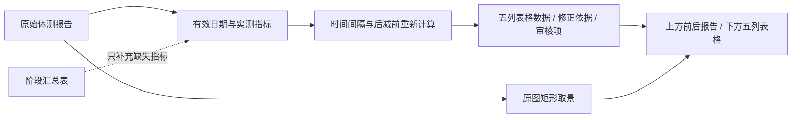

# 报告内容提取与报告对比成品

2026-11-07 最新规则：原始体测报告优先；缺失指标允许由阶段汇总表补充；天数、变化量由程序重新计算。原图取景沿用 3:4 矩形，成品保留去右上角姓名/门店、去底部来源提示的版式。

成品 v5 已由用户确认并正式归入 `best-practices/body-scan-delivery/report_comparison`，来源提交 `f1320dd32b3a2d3bec451ab9e2520058b15b3506`。使用独立入口 `report_comparison/run.sh`，部署时复制整个 `body-scan-delivery`。归档过程保留已确认算法和图片，独立验证记录见 [validation-approved-v5.json](../../best-practices/body-scan-delivery/report_comparison/validation-approved-v5.json)。

1. 识别读取原始资料，按 SHA 复用缓存；不从已经裁去信息的成品截图取数。
2. 日期校验：有效 20xx 年且不晚于上海时区处理日。20266 等超长年份、非法月日、未来日期过滤；有原始报告日期即替代错误汇总日期，无证据则留缺失。
3. 时间行按实际日历差计算，日期栏分别填写前后日期，变化量填天数，单位为“天”。
4. 每个指标优先原始报告；缺失单元格可用汇总表。保留来源，单位换算后用后减前计算，明确双侧指标分别计算；原填变化量不进入最终结果。
5. 姓名和门店以报告为准，目录用于分组和查找。异常、原值与修正依据在 JSON 中保存，HTML 提示；没有有效数据则不生成。
6. 成品层只展示九项：时间、身高、体重、体脂率、BMI、腰围、臀围、胸围、臂围。两侧都缺失则不画该行；一侧缺失则保留已知值，缺失处为“—”。其他指标保留在完整数据与 HTML 详情中。
7. 上下组合图和独立表格均消费同一数据契约，不调用模型。默认宽度为单张报告原图基准宽度的两倍，可指定整批宽度。有报告图时高度为宽度 1.25 倍；没有原始报告图时只输出紧凑表格区，去掉上下大面积留白。表格本身总高固定为宽度 0.398 倍，按实际行数均分行高。

入口：[报告提取最佳实践](../../best-practices/body-report-compare/README.md)、[报告成品最佳实践](../../best-practices/body-scan-delivery/report_comparison/README.md)。新规则不自动替换旧阶段分类证据，不影响已批准体测照片、三视图、VS、单图和封面。

全量验证：51 份原始资料对应 18 组、261 行，18 组均生成有效时间行。李禹衡依据两张原始报告修正为 2026-09-13 → 2026-10-16，共 33 天；体重 56.9 → 63 kg，变化 +6.1 kg。329 个原始实测单元格优先级、242 个数值变化量、30 个未变化的报告照片区域已核验，报告与成品节点共 96 项测试通过。验证记录分别保存在两个最佳实践目录中的 `validation-original-first-v3.json`。

成品 v4 复用上述数据，只筛选展示项：18 组共展示 143 行，完整 261 行仍可展开查看。预览批次统一使用 2160×2700，五至九行的表格均高 860px；成品包 64 项测试通过。记录见 `best-practices/body-scan-delivery/report_comparison/validation-core-nine-v4.json`。

成品 v5 将没有报告图的三组改为 2160×1068 紧凑表格，表格本身仍高 860px。三张表格与上一版对应内容逐像素一致，其余 15 张组合成品完全不变；表格数据均未修改。验证见 `best-practices/body-scan-delivery/report_comparison/validation-compact-v5.json`。
