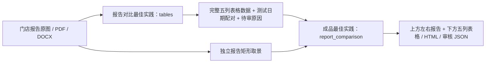

# 报告内容提取与报告对比成品

2026-11-07：按用户要求提炼阶段性训练成果报告，只重绘五列表格。取景仍沿用已确认的原图内 3:4 矩形。

- 已有明确前后列的表格时逐行转录，原填变化量保留，计算核验不覆盖原值。
- 没有表格时按日期配对实测报告，匹配指标、换算单位、计算差值。缺失不推造。
- 没有可靠表格及数据则不生成。只有表格时可生成独立表格图，缺少报告配对要返回原因。
- 分组仍使用原目录，报告会员姓名单独保存；用户明确展示以报告姓名和门店为权威；目录可能是教练名，名称差异、日期周期、多个版本、原值冲突均在预览及审核数据中提示。
- 宽度为同组单张报告原图基准宽度的两倍，遇前后宽度不一取较大值；高度为宽度 1.25 倍。可通过显式宽度统一整批输出，所有图片等比适配。
- 新数据包独立于旧报告契约，原照片阶段分类、体测照片标准化、三视图、VS、单图和封面均保持原行为。

上游：[报告提取](../../best-practices/body-report-compare/README.md)。下游：[报告对比成品](../../best-practices/body-scan-delivery/report_comparison/README.md)。验证记录随这两个最佳实践归档。本入口当前是独立预览工作流，未自动接入网站上传调度。

报告日期不可读时，只有在现成表格有明确前后列及日期、两侧分别至少两项有区分度的实测指标唯一匹配且无冲突时，才补充报告配对；显示日期取自原表并标记待核对。只有一项相同、多个候选或已知日期冲突均不能这样配对。
