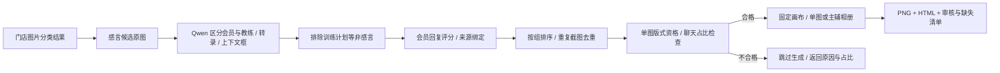

# 会员感言相册成品

2026-11-07：独立脚本已实现，先查看 HTML 效果，再决定正式归档。

1. 只处理 `xxx店` 的会员目录。候选取自已完成的图片分类；参考模板仅用于设计，不作为会员生产素材。
2. 识别按会员实际回复计分，训练计划、打卡或仅教练发言不构成会员感言。评分由文字长度、具体经历、情感表达、清晰度组成；不根据情绪正负淘汰反馈。
3. 产物固定为 1080×1440；全局配置可改为另一统一尺寸，不能按会员分别改尺寸。外边框与卡片分隔统一使用品牌红色。
4. 同一截图只放一次，相同文件内容去重。一张就单图，两张主辅，多张分页，各页不重复使用素材。
5. 单图保留完整相关对话区域，等比放入固定画布；选择右侧或底部标题板，图标和字号固定为首版红框的对应规格，不随剩余面板面积改变。截图框按实际展示高度或宽度收紧，尽量填满，不裁掉文字来凑比例。聊天截图实际像素面积必须至少占成品的 50%，标题区最多占 40%；单张和最终组合都检查。单张不合格就跳过该来源；两张分别合格但合成不合格，则输出两页单图，避免影响正常素材。
6. 原文只以截图呈现，不根据转录重新拼写聊天，不伪造评价。模型转录、分项评分、选图原因、原图和裁剪几何在 HTML/JSON 中可查。
7. 没有感言或截图比例不合格时跳过并给原因，不生成占位成品，不能借用其他会员的截图。HTML“未生成”筛选、结果 JSON、审核清单均保留原因；版式不合格记录为 `skip_kind=unsuitable_screenshot`，与 `missing_material` 缺素材区分。保留审核接口的数据位置和人工指定主图配置。

入口：[scripts/testimonial_album](../../scripts/testimonial_album/README.md)。识别与渲染分离，改变版式可复用既有证据，无须重复调用模型；现有体测图、报告和封面最佳实践不变。

本次实测：18 组生成 14 张单图红框成品；李禹衡与蒲小东因截图占比不足而跳过；易丽云、黎国萍缺素材。17 张候选中另剔除 1 张训练计划。17 项测试通过，包含来源去重、统一尺寸、等比截图像素保真、图标和字号固定、不合格无成品文件、同组保留合格图及双图失败时分页。当前预览与审核数据保留在 `artifacts/testimonial-album-v3/validated`；旧版产物仍保留。
