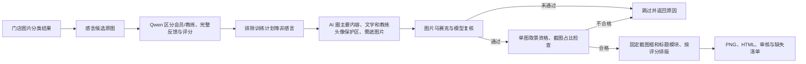

# 会员感言相册成品

2026-11-07：独立模板已实现，当前先通过 HTML 确认效果，尚未归档为正式最佳实践。

1. 只处理 `xxx店` 会员目录；参考模板和说明文件不参与生产。训练计划、约课或仅教练自述不能作为感言。
2. 会员回复按长度、具体经历、情感表达、清晰度评分；教练发言不参与评分，不按情绪正负淘汰。
3. 整批画布固定 1080×1440，红边框。截图框固定 `[15,15,1050,1159]`，标题区固定 `[15,1185,1050,240]`。**标题模块整体面积、位置、留白、图标和文字均一致**。标题 97 px、信封宽 193.6 px，保持首版横排规格；全局改宽度时统一缩放。
4. AI 圈完整主要反馈和允许取景区域。程序在原图中选择矩形，尽量填满截图框；保持所有主要气泡完整、等比缩放，不拉伸、不重写文字。主要内容框至少占取景 40%，实际截图至少占成品 50%；不合格来源跳过。
5. **只遮会员头像及人物照片（包括背景人物），保留所有对话文字、名字和右侧教练头像。** 右侧头像即使是人物照片也保留。程序用文字/教练头像保护区裁减图片遮罩，然后在副本上马赛克。源图已有遮挡不恢复。
6. 模型对原图与遮盖图进行第二次复核；遗漏可补框，误遮或仍不确定则不生成。渲染只接受当前隐私政策、已通过复核的证据。公开预览仅带遮盖后的截图、数字评分与几何，不附未遮原图或 OCR 原文；内部店名/会员导航保持。
7. 每张截图全组只用一次，按 SHA 去重。一张单图，多张主辅分页，每页至多两张。两张各自合格但合成不合格时拆两页，保持标题模块不变。
8. 没素材返回 `missing_material`；有素材但取景/隐私不通过返回 `unsuitable_screenshot` 及详细代码/原因，不写占位成品。HTML“未生成”、结果 JSON、审核清单一致返回。

入口：[scripts/testimonial_album](../../scripts/testimonial_album/README.md)。三个节点独立：感言识别评分 → 内容与隐私标注/复核 → 无模型渲染。第二节点可复用已绑定的内容框，第三节点可复用完整证据；上游体测、报告和封面流程不变。

验证：23 项测试覆盖固定尺寸、一图一次、保护区内文字/教练头像原像素不变、人物背景遮盖、坐标映射、等比渲染、未通过复核不导出与公共数据限制。全量实测和跳过统计见 [validation.json](../../scripts/testimonial_album/validation.json)。预览在工作区 `artifacts/testimonial-album-v4/validated/index.html`，旧预览保留，不再作为当前遮盖规则的结果。
