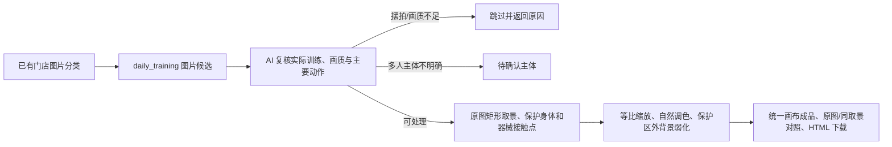

# 日常训练照片成品

2026-11-07：独立脚本 v1 已实现，先确认 HTML 效果，尚未归档最佳实践。生活照前后对比分支已按用户要求取消，本节点仅处理训练日常图片。

1. 复用 `daily_training` 分类，生产前复核动作可见度。只处理 `xxx店`，不读参考模板作为生产素材，不做视频抽帧，不判断训练前后。
2. 模型圈实际照片区域、主要人物、完整动作、握持器械/支撑物及必要教练区域。坐标从补白正方形映射回原图，异常或主体含糊返回复核。
3. 取景只使用原图内矩形，所有保护区域都必须保留。能铺满则铺满，横向动作完整等比嵌入；固定画布不能以拉伸人物或切断关键动作实现。源图已有截断保留记录。
4. 自然纪实美化：小幅曝光与白平衡、暗部提亮、高光压缩、轻度锐化；噪声高时轻度处理暗部。动作保护矩形外羽化压暗、降饱和；不精细抠图、不瘦身、不重绘器械。当前不做旋转扶正。
5. 默认 1080×1440、6px 红边、无标题；可配置 Logo 独立小条。有效画面至少占框 45%，短边至少 380px，放大最多 1.8 倍。每组最多 3 张，按分数选图并按 SHA 去重。
6. HTML 支持处理后、同取景调色前、完整原图切换及下载。待确认、拒绝、缺少候选均给出原因，返回 `review.json`，尚未接入既有网页审核 API。

入口：[scripts/training_daily](../../scripts/training_daily/README.md)。识别证据与渲染分离，后者不调用模型；已确认的六类成品最佳实践保持原样。

本轮：13 张候选 → 10 张成品，1 张主体待确认、2 张拒绝。11 项测试通过，具体逐图验收见 [validation.json](../../scripts/training_daily/validation.json)。预览位于工作区 `artifacts/training-daily-v1/validated/index.html`。
