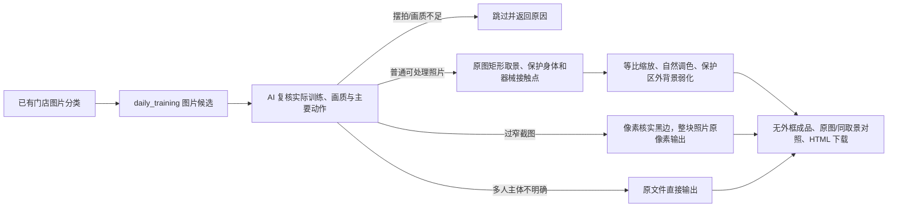

# 日常训练照片成品

2026-11-07：独立脚本 v2 已实现，先确认 HTML 效果，尚未归档最佳实践。生活照前后对比分支已按用户要求取消，本节点仅处理训练日常图片。

1. 复用 `daily_training` 分类，生产前复核动作可见度。只处理 `xxx店`，不读参考模板作为生产素材，不做视频抽帧，不判断训练前后。
2. 模型圈实际照片区域、主要人物、完整动作、握持器械/支撑物及必要教练区域。坐标从补白正方形映射回原图，证据异常返回复核。主体不明确且属于实际训练的，按用户要求直接复制原文件，不裁剪、不缩放、不调色，不猜主要人物。
3. 对 a0097 这类过窄截图，模型近似框仅作为查找黑边的提示；通过连续近黑像素带核实真实照片边界，去除填充黑边和其中的手机操作条。保留完整照片区域，按原像素输出，不套标准画布。短手机指示条不会被误认为第二张照片。该分支要求可读画质与高置信范围，不能将摆拍或模糊图自动放行。
4. 普通取景只使用原图内矩形，所有保护区域都必须保留。能铺满则铺满，横向动作完整等比嵌入；固定画布不能以拉伸人物或切断关键动作实现。源图已有截断保留记录。
5. 普通分支自然纪实美化：小幅曝光与白平衡、暗部提亮、高光压缩、轻度锐化；噪声高时轻度处理暗部。动作保护矩形外羽化压暗、降饱和；不精细抠图、不瘦身、不重绘器械。当前不做旋转扶正。两种原像素分支跳过全部美化及 Logo。
6. 所有成品无外框，旧 `border` 配置也按 0 处理。普通分支默认 1080×1440、无标题；可配置 Logo 独立小条。普通分支有效画面至少占框 45%，短边至少 380px，放大最多 1.8 倍。每组最多 3 张，按分数选图并按 SHA 去重。
7. HTML 按每张成品的真实比例显示；普通分支支持处理后、同取景调色前、完整原图切换。原像素分支不提供虚假的调色前后对比，下载对应实际格式。输出策略与模型证据状态分开记录，主体不明确走原图直出后不再等待指定主体；其他待确认、拒绝、缺少候选均给出原因。返回 `review.json`，尚未接入既有网页审核 API。

入口：[scripts/training_daily](../../scripts/training_daily/README.md)。识别证据与渲染分离，后者不调用模型；已确认的六类成品最佳实践保持原样。

本轮：13 张候选 → 12 张成品（10 张普通无框、1 张仅去黑边、1 张原图直出），覆盖 9 组；1 张摆拍拒绝，另 9 组没有候选。15 项测试通过，具体逐图验收见 [validation.json](../../scripts/training_daily/validation.json)。预览位于工作区 `artifacts/training-daily-v2/validated/index.html`。
