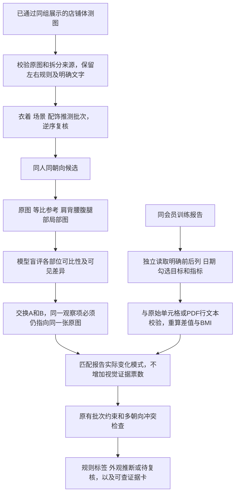

# 局部观察与训练报告辅助判断训练阶段

后续已新增[生成标签与审核重生成](body-scan-delivery-review.md)：本节点的分析结论和未知项保持原样；生成层采用已有推断、为其余项选择待审阶段并出成品，所有推断与待审均可回传人工修正。下述历史实验统计不代表新生成层仍有图片没有标签。

2026-11-06。用户批准新增独立实验：[scripts/body_scan_phase_regions](../../scripts/body_scan_phase_regions/README.md)。针对姿势、拍摄角度不一致导致轮廓叠加失真的问题，采用按部位检查可比性、并排局部对照、独立报告转录与最后融合。原图、标准化流程、同组展示最佳实践和旧阶段节点保留。

## 处理顺序

视觉提示词不包含报告、会员姓名、旧阶段标签、目标或期待的改善方向。报告转录调用不包含照片。最后融合由确定性代码完成，避免“先知道减脂了，再从照片中找变瘦”的暗示。

## 局部图与可比性

沿用已保存的 COCO 肩髋关键点，将坐标投影到等比参考图。关键点置信度不足时不生成有效局部证据。肩背、腰腹和腿部采用相同成对窗口尺寸和显示倍率，只平移窗口；不用腰宽缩放，不旋转肩线，不变形人体，不补造缺失身体。

局部图没有独立于原图的新证据身份。同一个腰腹的原图和放大图只能支持一个观察项。窗口真实像素覆盖不足85%时不可用；腿部还要求至少一个可靠膝点。可见范围不足仍显示说明和原图，不能悄悄删除照片。

窗口横向宽度先受两图共同可用画面宽度限制，必要时只平移以落在有效范围内；不把额外背景不够宽误判成人体部位缺失。这只改变上下文窗口，不改变图中人物像素倍率，两张图仍使用相同窗口宽度。

模型独立检查五项：腰腹收紧、腿部纤细、可见体态偏差、肩背肌肉外观、腿部肌肉外观。每项检查视角、姿势、衣物、光线、尺度和遮挡。抱臂可使肩背项无效，但不必否决仍可比的腿部；宽松衣物边界不能直接代表身体边界。能被摆姿、主动收腹、发力、相机角度解释的变化不参与排序。

原图和等比参考同时提供。非等比展示版 `display.png` 不参与模型判断；原图用于核查上游几何误差。局部图不是围度测量，不能得到厘米、公斤、体脂率或疾病结论。

## 报告读取与使用

只扫描根目录下 `xxx店` 的 PDF/DOCX，参考模板和说明目录排除。路径只能产生会员候选，正文姓名、门店还必须一致；多候选、无合格照片组或正文身份不匹配不自动使用。

PDF同时提供原页面与文本；DOCX读取原始段落和表格单元格。前后由明确列标题确定，支持两列位置交换，不能按“数值好坏”猜前后。目标只有明确勾选才记录；Word纯文本不能证实的勾选留空。

每个指标保留原始两格、单位、行名、页/表序号和源行，程序校验数值与源行/单元格对应。无法验证的指标单独拒绝。支持双侧臂围，变化按后减前重算，体脂变化记录百分点。报告原写变化量与重算不一致、填写天数与日期差不一致时保留警告；日期缺失或前后冲突时不参与报告辅助。无可验证文本的扫描PDF本版需复核，不把视觉转录直接当作已验证数据。

BMI用身高体重交叉检查，异常BMI不用于推断；BMI和体重不是独立证据。胸围/臂围增加不能等同于肌肉量增加。体重上升、体脂下降也不自动代表变差。

当前保守映射：体脂和腰围同向下降时，腰腹更收紧与报告训练后模式相容；二者都上升时，腰腹更收紧对应报告训练前模式。相互矛盾或缺少任一独立指标，不生成该映射。仅报告明确骨骼肌量变化时才建立肌肉项映射，不从臂围/胸围推算。报告没有体态量化数据时不猜报告体态变化。

报告**不会**把轻微观察升级为清楚变化，不会凭报告单独生成照片阶段，不会让不可靠拍摄批次传播，不会解除明确视觉冲突。没有报告或报告不合格时，退回局部视觉结果。多个阶段报告尚不能与照片对应时，不任意挑选一份。

报告未记录某项指标不等于已验证的视觉观察无效。例如报告没有骨骼肌量，但照片中存在清楚、可比且换序稳定的肌肉外观变化，仍保留为纯视觉证据；不会把它说成报告证实的肌肉增长。报告支持项和纯视觉项分开记录，方向冲突则复核。

报告与照片批次目前没有可靠日期绑定，因此报告辅助结果仍是 `inferred`，不是确认的拍摄时间。即使报告有明确前后日期，也不能承诺两批照片拍摄于这些日期。EXIF仅用于批次内部时间冲突检查，不以文件修改时间代替拍摄时间。

## 采用与复核

保留[批次版](training-phase-sessions.md)规则：左右硬拼接子图按用户左前右后规则；新文字标签须换序两次读取一致。一个清楚、可比且换序稳定的观察可支持推断；轻微观察需同一对可靠批次至少两个不同朝向一致。只靠相同衣服或背景不能确认同批。未知单张不能借另一对独立单张的判断自动继承。

同一呈现中清楚观察相反、跨朝向阶段相反、批次发生前后冲突时待复核，不多数投票。相同源图哈希直接禁止排序；额外负对照允许模型观察同图，用来记录原始误报，但不会采用。

## 对照实验

三条策略使用同一套原图与等比参考：旧整体观察、局部观察、局部加报告。旧结果只有原图、等比参考哈希均一致时才复用；参考更新的图片重新运行旧观察，避免把尺度更新效果混算成提示词效果。三条策略复用相同批次候选、源规则、换序和跨朝向解决逻辑。

通过 `--override` 引入最新批准的局部标准化结果时，校验原图、店名、会员、朝向一致，并继承基础输入已验证的拆分规则。覆盖不会添加新会员或修改原图。

没有可靠拍摄时间真值，本轮统计自动采用数、待复核原因、换序一致性、报告覆盖与负对照。不能把采用增多当准确率提高，也不能把采用减少当整体算法失败。实验结果与限制记录在脚本目录 `validation.json`；本节点尚未接入网站、统一调度或最佳实践快照。

## 本轮远程验证结果

最终输出：`/root/autodl-fs/case-studio/experiments/body-scan-phase-regions-v1-20261106/final-reviewed`。本机预览：`/Users/zhangming/Projects/FP16-Speed/artifacts/body-scan-phase-regions-v1/final-reviewed/index.html`。

覆盖当前全部已通过上游展示的82张、16位会员，27对需要视觉判断的候选。5组28张引用最新同组展示v3，其余54张保留现有参考；这不是对所有原始素材重新执行标准化，原有上游排除/失败仍单列。店铺中5份PDF/DOCX报告，4份匹配并通过转录核对；candy没有本轮合格照片组，只记录未匹配，不套给其他会员。

| 同一输入上的策略 | 原有规则标签 | 外观推断标签 | 待复核 |
| --- | ---: | ---: | ---: |
| 原整体观察 | 29 | 17 | 36 |
| 局部可比性与换序 | 29 | 19 | 34 |
| 局部与报告辅助 | 29 | 19 | 34 |

吴显昉 `a0091/a0098`、李禹衡 `a0151/a0159` 新获得推断；潘艺文 `a0161/a0162` 只剩轻微、换序一致的变化，且批次不够可靠，退回初步建议。报告在本批提供一致的变化模式，没有独立增加阶段标签。黎国萍正面与侧面方向冲突，整组保留复核，未用多数票抹除矛盾。

34张待复核包括：16张没有稳定可比局部证据、12张只有单朝向轻微证据、6张批次阶段冲突。照片均保留，并在预览展示原因和原始模型答复。

40项新测试、33项批次回归和20项原阶段回归，共93项通过。独立审计检查246个输入文件未变、29张位置规则标签保留、24个稳定局部观察项及475个预览链接。正/背/侧三个同图负对照均未获得阶段；背面同图仍触发模型原始方向误报，换序与相同来源保护阻止采用，因此不能把负对照说成模型完全正确。

最终重放99个缓存阶段，0个新增请求、0个未恢复调用错误；此前修正窗口后的推理轮新增57个请求。模型/API真实运行在服务器，最后一次只是复现检查。冻结最佳实践、旧结果、网站与原图未修改。
