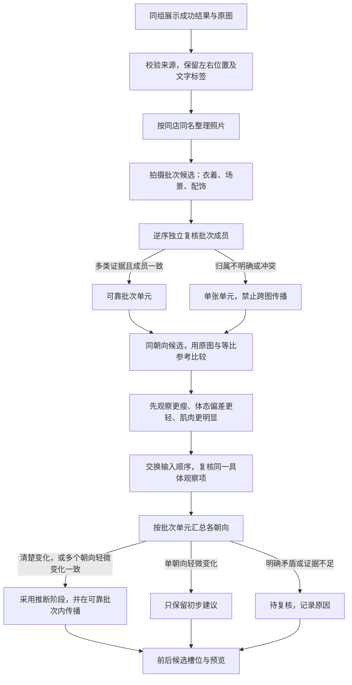

# 按拍摄批次与多朝向判断训练阶段

2026-11-06。用户批准“同人按拍摄批次分组 → 同姿势比较 → 综合多个朝向判断”。实现为新增独立节点 [scripts/body_scan_phase_sessions](../../scripts/body_scan_phase_sessions/README.md)。上一版 [逐对标注](training-phase.md) 保留，旧0.8置信度门槛只适用于旧版。

## 流程

## 批次归属

批次首先是候选，不根据体形变化或预期训练先后分组，也不强制两批。衣着、场景和配饰三类线索中至少两类有独立清楚证据，逆序复核成员仍一致，才能跨照片传递阶段。只有相同衣色、同一墙面或相同鞋子不足以证明同批。

存在同样布景重复拍摄的疑虑、同一候选内重复朝向、固定阶段标签冲突时，回退为单张单元。原图相机EXIF时间如果相差超过6小时，也阻止并批；没有时间不补猜，不使用下载/文件修改时间，EXIF不自动成为可靠训练阶段证据。原候选和不合并原因保存供复核。

单张单元仍可与同姿势照片比较，但不能把“某两张正面更瘦”的结论传给没有可靠批次关系的侧面/背面。

## 观察与采纳

| 证据 | 决策 |
| --- | --- |
| 左右硬拼接子图 | 左训练前、右训练后，保留用户规则来源 |
| 明确单图阶段文字 | 保留；新读取文字要求换序后指向同一原图 |
| 一个朝向出现清楚变化，同一观察项换序仍一致 | 可采用AI推断；可靠批次其他成员可继承 |
| 同一对可靠批次至少两个不同朝向出现方向一致的轻微变化 | 可采用多朝向推断 |
| 只有一个朝向存在轻微变化 | 初步建议，不进入已采用槽位 |
| 受衣物/发力/镜头/光线影响，或姿势/朝向不可比 | 不作为排序证据 |
| 不同朝向方向相反，或同一批次被提议为前和后 | 关联比较范围待复核，不靠多数票消除冲突 |

模型不直接输出“前/后”，而是描述改善项的A/B方向，再由程序统一映射为训练后；避免“肌肉更多”的方向被填反。不要求三种指标全部改善。清楚的线索优先于轻微线索，清楚线索彼此相反时不选择。模型自报置信度仍保存，但不直接作为概率或硬门槛。

侧面候选包含上游side/side_left/side_right，模型须确认是否同侧、同姿势；不因标签不一致自动漏配，也不把相反侧强行配对。原view保留，判断关系另记录比较朝向。

始终使用原图和等比参考，禁止使用经过非等比调整的展示版推断变化。阶段是用户约定或AI外观推断，不冒充经过验证的拍摄日期。

## 接口与异常

输入仍为 `body-scan-group-display-v2` 的成功结果，通过原图SHA及父子报告绑定来源。`--baseline` 仅统计相同原图的旧版标签变化，不向模型提供旧结论。每个会员最多12张；更大组明确待复核，输入不丢失。会员组之间可并发处理，组内按依赖顺序执行。

所有产物写入新目录：完整标签、批次候选和实际单元、逐对原始答复、采用理由与冲突、槽位和离线预览。旧版代码、旧结果、标准化图及最佳实践不覆盖。尚未接入网站及统一调度。

网络/响应格式失败与“无明显变化”分开记录。仅传输失败、可重试HTTP状态或无效/截断JSON最多重试一次；有效语义答案不反复询问。缓存按模型、提示词版本和原始输入像素绑定。
