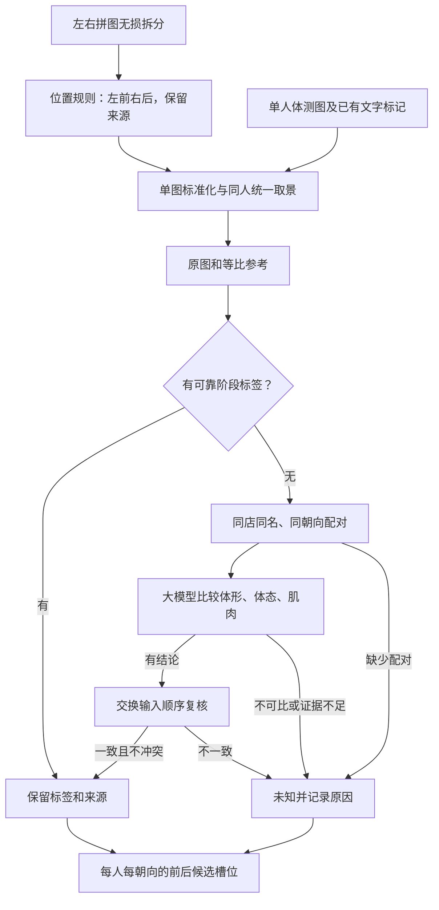

# 训练前后标注工作流

记录日期：2026-11-05。当前实现：[scripts/body_scan_phase](../../scripts/body_scan_phase/README.md)。此节点增加阶段标签，不改变已批准的图片。统一调度、网站与最终成品模板尚未接入。

2026-11-06：本页保留v1记录。新增独立的[拍摄批次与多朝向版本](training-phase-sessions.md)，置信度仅作参考，按可见变化与批次一致性采纳；不修改本页所述旧版实现和结果。

## 用户确认的规则

| 来源 | 规则 | 记录方式 |
| --- | --- | --- |
| 左右硬拼接体测图的合格子图 | 左侧训练前，右侧训练后 | `comparison_position_rule`；保留父图、真实裁切位置及规则版本 |
| 其余图有可靠单图文字标记 | 使用明确训练前/后文字 | `explicit_marker` 或 `vlm_explicit_markers`，保留原文 |
| 无标记，同人同姿势有可比照片 | 较胖为前、较瘦为后；体态偏差较明显为前、较轻为后；肌肉更明显/发达为后 | `vlm_appearance`；保留三项依据、置信度、配对ID和换序复核 |
| 单张、线索冲突、姿势不同、差异不足 | 不强制分配训练前后 | `unknown / needs_review`，说明具体原因 |

这替代旧文档中一概禁止左右/体形排序的规则。位置标签是用户约定，外观标签是模型推断，均不自动成为已验证的拍摄时间或训练效果。上下拼图不使用左右规则；模型不根据输入顺序、衣服颜色、相机距离或照片新旧赋值。

## 与既有节点衔接

新拆分开发版在子图生成时标注阶段，在标准化报告中传递 `phase_evidence/pair_source`。冻结拆分版本保留；旧结果由本节点验证父子报告后适配，无须重跑原图处理。当前适配器消费 `body-scan-group-display-v2`，回溯标准化配置指向的原始 job。

推断使用原图核对衣着、姿势、光照和透视，以同组等比参考辅助比较。不使用轻微纵向拉伸的展示版，避免把展示处理当作体形变化。原本的身体倾斜不能因校正参考图而直接当作改善。

## 决策与质量控制

- 三种线索分别记录，不要求三项都可见，但至少一种有明确依据。默认接受门槛为模型自报置信度0.8；可信线索矛盾则未知。
- 初审有有效结论后交换输入顺序再比较，只有指向同一原图才接受；初审拒绝不继续投票求放行。
- 同朝向多张两两比较，提议冲突保留未知；超过6张暂待复核，避免无界扩展请求量。不会宣称所有照片恰好来自两个拍摄时点。
- 可靠标签不被外观判断覆盖，相冲突的提议不传播给另一张。同组其他朝向不能仅靠服装相同继承标签。
- 原图、参考图和父子关系均绑定SHA，输入更换则停止。API失败/格式错误保留待复核；缺少同姿势配对不等于上游丢图。
- `phase=before/after/unknown` 与 `view` 独立。`slots.json` 输出候选列表，后续节点再选素材。`summary.json` 包含全部当前成功输入，不省略未知项。
- 低置信度但有方向的模型答复另存 `suggestion`，预览标为“AI初步建议（未采用）”；正式 `phase` 仍未知，不能直接用于成品槽位。换序反向或同组建议冲突时不合并成单一建议。

## 验证范围

仅在远程推理，沿用已有42张成功图、11名会员，含2张来自同一左右拼图的子图；不是整个上传包。预览展示等比参考、原图和逐对判断。实际统计见脚本目录 `validation.json`。

测试验证规则、冲突处理、来源绑定和图片不变；模型自报置信度及正反序一致性不等于语义准确率。
